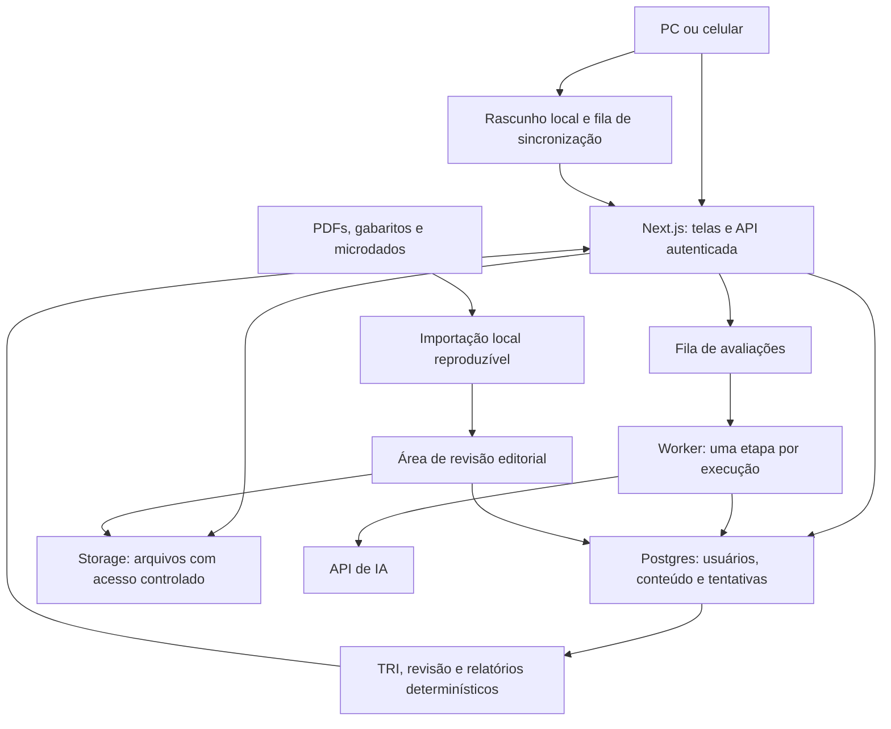

# Resolve — pacote completo para o Claude

Este arquivo reúne a instrução de execução, o plano consolidado e o backlog completo. Inclui a atualização de Guto sobre animações personalizadas em todo o contexto do produto. É suficiente como anexo de planejamento para começar; PDFs, dados de prova, corpus de redações e acessos entram nas tarefas que dependem deles.

**Nome escolhido: Resolve.** Aplique essa marca na interface, nos títulos e nos materiais. Caderno de Prova é a direção visual aprovada.

## Como usar

Envie este arquivo ao Claude no ambiente em que ele vai trabalhar no projeto. Pode acompanhar o anexo com esta mensagem:

> Este é o plano da Resolve, minha plataforma de preparação para o ENEM. Leia o pacote completo e comece a implementação pelas tarefas liberadas da F1, respeitando as dependências. Quero a identidade A e o acabamento de movimento autoral descritos no §8. Entregue protótipos navegáveis cedo e registre o avanço por ID para continuarmos nas próximas sessões.

O arquivo de checagem da Rodada 4 é um histórico opcional. Todas as correções necessárias à execução já estão incorporadas abaixo. Quando o texto mencionar os dois arquivos consolidados, seus conteúdos completos correspondem às partes A e B deste pacote.

## Instrução de execução

Você vai implementar a Resolve, plataforma de estudo para o ENEM. O dono e primeiro usuário é Guto. Use o plano e o backlog abaixo como especificação; preserve os requisitos aprovados e identifique decisões ainda abertas. O nome Resolve já foi escolhido.

1. Inspecione o repositório e as instruções locais. Preserve trabalho existente. Em projeto novo, comece por F1-T01. Registre plano, tarefas e progresso em documentos do projeto para retomada entre sessões.
2. Trabalhe por tarefas de até quatro horas, respeitando as dependências. Uma funcionalidade está concluída quando seu critério de pronto foi verificado. Se surgir um trabalho maior, divida e registre os novos IDs; não esconda uma implementação inteira numa tarefa de integração.
3. Produza cedo os protótipos da F1: questão longa, correção, rotina, movimentos contextuais e os três momentos principais. Use os dados demonstrativos apenas onde permitidos e identifique-os. Uma questão apresentada como oficial deve ter fonte real; a falta de PDF não impede componentes e outros protótipos independentes.
4. A identidade é Caderno de Prova: A com os recursos de visualização de B, todos usando as fontes e a paleta de A. O escuro deriva da tinta. Amarelo e rosa são preenchimentos, com texto em tinta/papel. A rotina usa tarefas e calendário como referência de organização.
5. O acabamento de movimento é requisito do produto. Desenhe a relação entre o objeto acionado e o resultado. Implemente as coreografias do §8, produza gravações e refine os detalhes antes de replicar a linguagem. Mantenha os três momentos principais: envelope/caderno 3D, transição entre etapas e replay.
6. Durante leitura e escrita, a interface fica estável. Movimento explica a ação solicitada, preserva contexto e oferece redução. A dificuldade de implementar um efeito não autoriza cortar silenciosamente a direção visual.
7. Construa o primeiro ciclo utilizável e avance pelos seis núcleos da V1. Não declare a V1 completa ao concluir o piloto. As 14 camadas da visão conservam sua prioridade e seus critérios.
8. Use somente questões reais no banco principal. Não preencha lacunas de parâmetros, notas, fontes ou estatísticas com dados inventados. Trabalho que depende de dados reais permanece identificado, enquanto partes independentes podem avançar.
9. Use resoluções e etiquetas revisadas no estudo cotidiano; reserve IA para os recursos especificados. Mantenha orçamento, rastreabilidade, rascunhos recuperáveis e isolamento dos dados por usuário.
10. As faixas de TRI e redação, o desempenho móvel e a qualidade visual precisam de evidência. Documente quais testes rodaram e seus resultados; um teste escrito ou um protótipo estático não demonstra esses resultados.
11. Ao encerrar uma sessão, registre IDs concluídos, arquivos alterados, verificações realizadas, pendências concretas e próximo trabalho liberado. Não reconstrua o planejamento do zero a cada retomada.

**Primeiro resultado visual esperado:** identidade aplicada e protótipo navegável em PC/celular, com o cartão de Hoje entrando no foco, a lógica de anotações do Raio-X/correção e a direção dos três momentos principais. Execute os recortes conforme as dependências; se um material faltar, conclua os demais e registre exatamente onde ele será necessário.

**Contagem atual:** 182 tarefas — 120 nas trilhas da V1, 53 na visão e nove pilotos opcionais. As sete tarefas novas de movimento são F1-T16 a T18 e F6-T10 a T13. Os experimentos de fotografias próprias e de transformação da constelação continuam condicionados aos testes previstos.

---

# Parte A — plano consolidado completo

# Resolve — plano de construção

Plano consolidado após a Rodada 4 · 8 de novembro de 2026 · Especificação para Guto e para execução pelo Claude.

**Nome escolhido por Guto: Resolve.** Usar essa grafia na interface, nos títulos, nos materiais e na documentação do produto.

Atualização posterior solicitada por Guto: ampliar o acabamento de movimento para ações, mudanças de estado e navegação contextual em todo o produto. O §8 detalha essa direção; o backlog atualizado contém 182 tarefas. Os três momentos principais permanecem.

Este plano incorpora o documento original, as escolhas explícitas de Guto e a checagem de consistência da Rodada 4. A identidade é **Caderno de Prova**, com recursos de visualização de B usando exclusivamente a identidade de A. Recomendações técnicas e critérios numéricos continuam identificados como propostas; a checagem não equivale à validação de um produto implementado.

**Leitura:** 3a contém as seções 1–5; 3b contém 6–8; 3c contém 9–14. O arquivo `ENEM-tarefas-consolidadas.md` contém o detalhamento executável da seção 9. O registro de cobertura e mudanças está em `ENEM-checagem-rodada-4.md`. Os arquivos da Rodada 3 foram preservados como histórico.

Os fatos sobre formato, matriz, redação e mudanças do ENEM são premissas do documento fornecido. Este plano não confirma novas regras para 2027 ou 2028. A implementação deve registrar a fonte oficial e a versão de cada regra antes de ativá-la. Números de desempenho e de qualidade definidos aqui são **metas de aceitação propostas**, não resultados já obtidos.

---

**3a — Escopo, arquitetura, dados e banco**

## 1. Resumo do plano

1. Construir uma plataforma pessoal de preparação para o ENEM 2027, preparada para receber outros usuários.
2. Entregar primeiro um ciclo utilizável de questão real, Raio-X, registro de erro e revisão.
3. Completar a V1 com diagnóstico/TRI, quatro treinos, rotina/foco e redação com biblioteca nota 1000.
4. Publicar questões somente depois de conferir conteúdo, gabarito, origem e etiquetas.
5. Usar uma identidade editorial de caderno, com cuidado equivalente no PC e no celular.
6. Produzir envelope/caderno em 3D, transições entre etapas e replay como momentos de maior impacto.
7. Mostrar estimativas, incerteza e limitações de acordo com a validação disponível.
8. Guardar conteúdo revisado e limitar o uso recorrente de IA.
9. Construir as 14 camadas posteriores sem remover os seis núcleos ou os nove momentos aprovados.
10. Executar por tarefas de até quatro horas, com dependências e critérios verificáveis.

### Escopo das entregas

| Entrega | O que Guto recebe | Condição de conclusão |
|---|---|---|
| Primeiro ciclo utilizável, dentro da V1 | Conta, pelo menos 30 questões reais diversificadas e revisadas, resposta salva, Raio-X, motivo opcional, caderno e revisão | Uso durante sete dias; recuperação após interrupção; revisões aparecem nas datas corretas; nenhum item sem revisão é apresentado |
| Fundação quantitativa | Uma edição completa revisada; identificação dos itens nas cores; parâmetros e agregados disponíveis; cálculo TRI auditável | Testes da seção 10 passam no conjunto declarado; recursos indisponíveis continuam explicitamente identificados |
| V1 completa | Os seis núcleos, todas as funções detalhadas de redação e biblioteca, rotina e metas, quatro habilidades, mapa/constelação inicial e revisão | Todos os critérios G1–G6 da seção 10 passam; a primeira semana utilizável não substitui esta conclusão |
| Visão | Plano adaptativo e as outras 13 camadas, na prioridade do documento | Cada camada possui dados, teste e entrega próprios; sem ativação automática por calendário |

O primeiro lote de 30 serve para encontrar falhas do processo. O objetivo do banco da V1 é uma edição completa, com pelo menos 180 itens, e expansão para duas ou três edições. Variantes de língua estrangeira e outras variantes presentes nos arquivos serão preservadas, sem assumir que 180 cobre todos os itens publicados de uma edição.

**Prioridade didática da sessão:** retomada pendente → revisão vencida que caiba no bloco → treino recomendado com evidência suficiente → lista curta de questões. O aluno pode escolher outra atividade. A entrada direta no próximo treino é uma hipótese a testar, não uma obrigação de navegação.

**Originalidade:** TRI estimada, correção por IA, agenda e plano adaptativo já aparecem em concorrentes citados no documento e nas referências. Perfil de distratores, triagem, cenários de pontos perdidos e as combinações visuais têm ineditismo não verificado. O produto não deve anunciar exclusividade sem pesquisa específica.

## 2. Stack

| Camada | Escolha proposta | Motivo e limite |
|---|---|---|
| Aplicação | Next.js, React e TypeScript | Uma aplicação para PC e celular; conteúdo e autorização no servidor; interação no cliente apenas onde necessária |
| Estilos | CSS com tokens e Tailwind para composição | Uma fonte de cores, fontes, espaçamentos e estados; nenhum tema independente para gráficos |
| Componentes | Primitivas acessíveis de Radix; componentes próprios | Controle de teclado e foco com identidade própria; exemplos do 21st.dev são referências, não um tema pronto |
| Dados e conta | Supabase Postgres, Auth e Storage | Dados relacionais, acesso por usuário e arquivos privados; migrações SQL versionadas |
| Tarefas de IA | Supabase Queues, Cron e Edge Functions | Uma etapa por mensagem: avaliação A, avaliação B, eventual C e consolidação; retomada após falha |
| Importação editorial | Python, pdfplumber, pypdfium2, DuckDB e Parquet, executados localmente pelo operador | PDFs e microdados grandes ficam fora do servidor da aplicação; apenas itens, parâmetros e agregados aprovados são publicados |
| Matemática | KaTeX com entrada permitida e sanitizada | Fórmulas legíveis; figuras originais continuam disponíveis |
| Validação de entradas | Zod e restrições SQL | Conferir contratos da IA, formulários, notas, relações e estados |
| Gráficos | SVG e escalas do d3-scale | Rótulos acessíveis, versão tabular e controle de movimento; evitar canvas para texto e navegação |
| Movimento cotidiano | Motion | Abas, gestos, reorganização e transições pequenas |
| Sequências | GSAP | Scanner, passagem entre etapas e correção com traço; um controlador por propriedade |
| Envelope em 3D | Modelo autoral em Blender; clipe pré-renderizado como escolha inicial | Qualidade de luz/material com reprodução previsível; testar cena em tempo real apenas se houver interação que justifique o custo |
| Persistência local temporária | IndexedDB | Rascunho e fila curta de respostas quando a conexão cai; não promete funcionamento completo sem rede |
| Verificação | Vitest, Playwright e axe-core | Cálculos, autorização, fluxos reais e acessibilidade; testes visuais dos estados críticos |
| Hospedagem inicial | Vercel para a aplicação; Supabase para dados | Operação pequena; planos pagos quando a finalidade e o uso exigirem |

Fixar versões compatíveis no início da implementação e registrar licenças. A escolha de biblioteca não dispensa a verificação de toque, teclado e leitor de tela.

A divisão servidor/cliente segue a [documentação do Next.js](https://nextjs.org/docs/app/getting-started/server-and-client-components). A fila utiliza recursos documentados em [Supabase Queues](https://supabase.com/docs/guides/queues); o consumidor deve continuar idempotente quando uma mensagem reaparece após o prazo de visibilidade. Os [limites de Edge Functions](https://supabase.com/docs/guides/functions/limits) justificam deixar PDFs e agregações grandes no processo local.

Redução de movimento: preferência do sistema, acrescida da opção interna “Reduzir movimento”; qualquer uma delas ativa a redução. [Motion oferece suporte a essa preferência](https://motion.dev/docs/react-accessibility). Sequências GSAP devem receber a mesma configuração. Som desligado por padrão; nenhuma informação depende dele.

## 3. Arquitetura

### Regras de funcionamento

1. A leitura de uma questão recebe texto, figuras, alternativas e origem. Gabarito, resolução e etiquetas explicativas são entregues após resposta ou escolha explícita de ver ajuda. Se houver ajuda, a tentativa fica marcada.
2. A confirmação da resposta e a criação/atualização do item de revisão acontecem em uma transação. `client_action_id` único impede duplicações ao reenviar.
3. O horário de uma prova usa prazo persistido no servidor. Em treino, pausas explícitas são permitidas. Suspender a aba não aumenta artificialmente o tempo de estudo, nem pausa o prazo de uma prova realista.
4. O Raio-X usa resolução e etiquetas revisadas. O caminho normal de uma questão não chama IA.
5. A submissão de redação cria uma versão imutável e um trabalho com chave única. Os dois avaliadores recebem o mesmo texto e rubrica, sem a resposta do outro. A terceira avaliação também começa sem as avaliações anteriores.
6. Cada etapa de IA reserva orçamento antes da chamada. Timeout de resultado desconhecido gera reconciliação e limite de repetição; não existe promessa de cobrança exatamente uma vez pelo provedor.
7. A aplicação expõe “Na fila”, “Em análise”, “Pronto”, “Precisa de nova tentativa” e “Limite atingido”. O rascunho continua acessível em qualquer estado.
8. Conteúdo de PDFs, redações e páginas é tratado como dado. A IA não recebe ferramentas de execução ou navegação livre durante correção e etiquetagem.
9. O servidor autoriza todas as escritas. Políticas por usuário protegem dados pessoais; papel de editor e segredos de serviço nunca são controlados por um campo editável no cliente.
10. Exportação e exclusão de conta abrangem redações, anexos, progresso e rascunhos locais. Antes da abertura ao público, revisar privacidade, uso por menores e direitos de republicação, conforme os riscos do documento.

### Organização sugerida do repositório

`apps/web` contém telas e rotas; `packages/domain` contém revisão, contratos e regras; `packages/tri` contém cálculo e fixtures; `packages/ui` contém tokens e componentes. `supabase/migrations` e `supabase/functions` guardam banco e workers. `tools/ingest` contém a importação local. `docs/decisions`, `docs/validation` e `docs/handoffs` registram decisões, resultados e continuidade entre sessões.

Não adicionar serviços separados de busca, vetores, analytics ou experimentação na fundação. Busca por filtros e texto do Postgres atende ao primeiro banco. A ampliação depende de medição.

## 4. Modelo de dados

Convenções: IDs UUID; tempos UTC; fuso do usuário separado; campos de autoria e criação nas entidades editáveis; versões publicadas imutáveis. JSONB serve para blocos ricos e saídas de modelo, com esquema validado. Relações, notas, alternativas e estados importantes têm colunas e restrições próprias.

### 4.1 Prova, matriz e conteúdo

| Tabela | Campos principais | Relação e regra |
|---|---|---|
| `exam_profiles` | `id, label, target_year, matrix_version_id, essay_rubric_id, day_rules_json, status, source_id` | Duração, quantidade, opções de língua e regras vêm de um perfil versionado; proposta futura não fica ativa |
| `matrix_versions` | `id, label, effective_from, source_id, status` | Versões não sobrescrevem histórico |
| `areas`, `competencies`, `skills` | `id, matrix_version_id, code, label, description, parent_id` | Área → competência → habilidade; códigos iguais em versões distintas têm IDs diferentes |
| `subjects`, `skill_subject_links` | `id, parent_id, label`; `skill_id, subject_id` | Assuntos hierárquicos e associação muitos-para-muitos |
| `sources` | `id, title, institution, url, edition, retrieved_at, sha256, rights_status, storage_path` | Proveniência de PDF, gabarito, matriz, cartilha, texto motivador e dados |
| `applications`, `booklets` | `id, year, type, profile_id`; `id, application_id, day, color, language, source_id` | Representam a aplicação e suas variantes |
| `stimulus_versions` | `id, source_id, blocks_json, fingerprint, shared_group_id` | Texto-base ou imagem compartilhado por mais de uma questão; evita duplicação e permite treino de blocos |
| `items` | `id, official_item_code, canonical_fingerprint, origin_type` | Identidade estável; banco principal aceita apenas `official_enem` |
| `item_versions` | `id, item_id, stimulus_version_id, command_blocks, area_id, content_dependency, explanation_steps, review_status, version` | Dependência de conteúdo entre 0 e 3; versão fixada pela tentativa |
| `item_skill_tags`, `item_subject_tags` | `item_version_id, skill_id/subject_id, is_primary, confidence, reviewer_id` | Etiquetas propostas e revisão humana distintas |
| `alternatives` | `id, item_version_id, stable_key, content_blocks, is_correct` | Cinco alternativas na configuração atual do documento; uma correta para item válido; não expor gabarito no DTO inicial |
| `booklet_items`, `booklet_alternative_maps` | `booklet_id, position, item_version_id, source_page`; `booklet_item_id, printed_letter, alternative_id` | Conservam ordem e letras da variante original |
| `assets` | `id, source_id, page, bbox, storage_path, media_type, width, height, alt_text, sha256` | Recorte ligado ao original; texto alternativo não pode revelar a resposta |
| `evidence_annotations` | `id, item_version_id, target_type, block_id, start_utf16, end_utf16, asset_id, normalized_bbox, explanation_step_id, rationale` | Texto, múltiplos trechos, região de figura ou passo de cálculo; offsets referem-se à versão exata |
| `distractor_types`, `alternative_annotations` | `id, taxonomy_version, label, definition`; `alternative_id, type_id, is_primary, rationale, review_status` | Pode haver tipo primário e secundário; “não classificado” exige justificativa editorial |
| `editorial_reviews` | `id, entity_type, entity_version_id, reviewer_id, checklist, decision, notes, created_at` | Aprovar, devolver ou rejeitar; não confundir revisão do conteúdo com revisão de estudo |

Taxonomia inicial: extrapolação, redução, contradição, verdade fora do comando, inversão de causa e efeito, generalização, isca de palavra e erro de cálculo previsto. Guardar definição, exemplo revisado e limites de cada tipo. A distribuição do perfil usa o tipo primário como denominador; múltiplas etiquetas não podem duplicar o total de erros.

### 4.2 TRI e estatísticas

| Tabela | Campos principais | Relação e regra |
|---|---|---|
| `parameter_sets` | `id, source_id, application_id, area_id, model_family, link_function, scale_transform, config_hash` | Mesma versão/configuração usada no cálculo e na validação |
| `item_parameters` | `parameter_set_id, item_id, a, b, c, valid, exclusion_reason` | Nunca transformar ausência de parâmetro em zero |
| `response_populations` | `id, application_id, source_id, filters_json, denominator_rule, n, pipeline_version` | Define quem entra no percentual e como branco/inválido é contado |
| `alternative_statistics` | `population_id, item_id, alternative_id, n_selected, n_eligible, proportion` | Percentual por alternativa; branco/inválido ficam em campos/categorias próprios |
| `tri_model_versions` | `id, parameter_set_id, prior_config, integration_config, transform_config, code_hash, validation_status` | EAP e transformações auditáveis; não misturar escalas sem ligação validada |
| `score_estimates` | `id, user_id, session_id, area_id, model_version_id, included_attempt_ids, estimate, lower, upper, interval_kind, n_effective` | Uma estimativa por área; cada faixa informa significado e população validada |
| `score_scenarios` | `id, base_estimate_id, changed_attempt_ids, estimate, delta` | Recalcula o conjunto; diferenças de cenários não são parcelas somáveis |
| `validation_runs` | `id, feature, dataset_manifest, split, code_hash, metrics_json, passed, created_at` | Preserva teste cego e resultados de cada versão |

Microdados individuais não são copiados para o banco do produto. A agregação local guarda somente as estatísticas necessárias. A amostra de referência para validar TRI fica isolada do produto, com campos mínimos e controle de acesso.

### 4.3 Usuário, treino, erro e revisão

| Tabela | Campos principais | Relação e regra |
|---|---|---|
| `profiles`, `user_preferences` | `user_id, display_name, timezone, target_exam`; `theme, reduced_motion, text_scale, default_language` | Vinculados à conta de autenticação |
| `study_sessions` | `id, user_id, mode, status, profile_id, started_at, deadline_at, ended_at, planned_minutes` | Modos de treino, diagnóstico, revisão, foco e simulado |
| `session_items` | `id, session_id, item_version_id, booklet_item_id, position, selection_reason, exposure_group_id` | Congela a lista e sua ordem; textos compartilhados mantêm dependência conhecida |
| `attempts` | `id, user_id, session_item_id, chosen_alternative_id, is_correct, client_action_id, submitted_at, confidence, help_seen, is_repeat, active_ms, elapsed_ms` | Uma confirmação lógica por ação; alterações anteriores ficam nos eventos |
| `attempt_evidence`, `attempt_distractor_choices` | `attempt_id, target, ranges_or_bbox`; `attempt_id, alternative_id, type_id, justification` | Medidas próprias de comando e eliminação |
| `triage_decisions` | `attempt_id/session_item_id, decision, decided_after_ms, resolved_attempt_id` | Agora/depois/chute; ligar à resolução posterior quando existir |
| `attempt_events` | `id, user_id, session_id, session_item_id, event_type, client_at, server_at, payload, sequence` | Eventos discretos; não armazenar cada tecla, cursor ou rolagem |
| `error_entries` | `id, user_id, item_id, first_attempt_id, latest_attempt_id, reason, resolved_at` | Um erro ativo por usuário/item; motivo pode ser `not_reported` |
| `review_items`, `review_events` | `id, user_id, item_id/card_id, stage, due_at, scheduler_version`; `review_item_id, attempt_id, outcome, next_due_at` | Agenda reproduzível; intervalos ligados ao fuso, sem duplicação por reenvio |
| `concept_cards` | `id, subject_id, front, back, source_ids, review_status` | Fórmulas e conceitos revisados; separados de questões oficiais e fora da TRI |
| `skill_evidence` | `user_id, skill_id, fresh_unassisted_n, distinct_items_n, recent_accuracy, status, computed_at, rule_version` | Sinal operacional de domínio, com contagem e limites expostos |
| `lesson_templates`, `lesson_progress` | `id, subject_id, stages, item_ids, resource_ids`; `user_id, stage, assistance_level` | Pergunta inicial → modelo → prática assistida → prática independente → mistura → revisão |

### 4.4 Rotina e metas

| Tabela | Campos principais | Relação e regra |
|---|---|---|
| `availability_rules`, `fixed_commitments` | `user_id, weekday, start_time, end_time, timezone, date_overrides` | Horários recorrentes e exceções |
| `goals` | `id, user_id, level, area_id, target_score, target_minutes, period_start, period_end` | Meta por área, semanal e diária |
| `study_blocks` | `id, user_id, type, planned_start, planned_minutes, actual_minutes, source_task_id, status` | Planejado, em curso, concluído, remarcado ou dispensado |
| `if_then_plans` | `id, user_id, trigger_text, alternative_activity, duration_minutes, priority` | Alternativa explícita para dias difíceis |
| `focus_intervals`, `rest_days` | `block_id, start, end, pause_kind`; `user_id, date, reason` | Sessões de 25–50 minutos; folga preserva a regra de sequência definida |
| `weekly_summaries` | `user_id, week_start, planned_minutes, logged_minutes, learning_metrics, computed_at` | Resultado derivado, reconstruível |

### 4.5 Redação e biblioteca nota 1000

| Tabela | Campos principais | Relação e regra |
|---|---|---|
| `essay_axes`, `essay_prompts` | `id, label`; `id, axis_id, title, instruction, source_ids, status, generation_version` | Tema publicado após conferir textos motivadores; nenhum dado inventado |
| `motivating_texts` | `id, prompt_id, excerpt, source_id, page_or_locator, rights_status` | Citação e rastreabilidade |
| `essay_rubrics`, `rubric_dimensions` | `id, version, source_id, discrepancy_rules`; `rubric_id, code, description, allowed_scores` | Cinco competências conforme a premissa atual do documento |
| `essays`, `essay_versions` | `id, user_id, prompt_id, training_piece`; `id, essay_id, parent_id, paragraphs_json, plain_text, layout_profile_id, simulated_lines, sha256` | Rascunhos e submissões separados; reescrita preserva versões |
| `essay_layout_profiles` | `id, version, font_asset_hash, font_size, line_height, canonical_width, line_limit, wrapping_version` | Contagem digital reproduzível, independente da largura do aparelho |
| `essay_jobs`, `essay_evaluations` | `id, version_id, rubric_id, model_policy_id, status, idempotency_key`; `job_id, evaluator_slot, scores, total, evidence, feedback, model_id, prompt_version, usage_id` | Slots A/B/C independentes de conteúdo; resultado fica vinculado ao texto submetido |
| `essay_results` | `job_id, aggregation_version, evaluator_range, calibrated_lower, calibrated_upper, calibration_run_id, status` | Intervalo das avaliações separado da faixa calibrada; resultado sem calibração é rotulado como tal |
| `essay_annotations` | `evaluation_id, paragraph_id, start_utf16, end_utf16, competency, intervention_element, comment` | Agente, ação, meio, finalidade e detalhamento; ausência pode ser indicada sem fabricar trecho |
| `exemplar_essays`, `exemplar_annotations` | `id, theme_id, author_credit, official_score, source_id, page, text_version, rights_status`; `exemplar_id, layer, anchor, comment` | Biblioteca nota 1000 com autoria e origem; comentários oficiais e editoriais identificados |
| `exemplar_readings` | `user_id, exemplar_id, theme_note, thesis_note, arguments_note, proposal_note, comments_revealed_at` | Leitura sem comentários antes da comparação; reabrir não apaga a tentativa |
| `essay_outlines`, `repertoire_entries`, `repertoire_uses` | `exemplar_id, structure`; `id, axis_id, source_id, explanation`; `entry_id, essay_id/exemplar_id, relevance_note` | Esqueleto, repertório por eixo e ligação com o tema |
| `essay_learning_steps` | `user_id, step, artifact_id, completed_at` | Trilha Redação do zero e treino por peças |

### 4.6 Operação e extensões

`ai_usage` guarda provedor, modelo, tokens de entrada/saída, preço aplicado, custo estimado/faturado, recurso e usuário. `ai_budgets` guarda limite, reservado, consumido e período. `job_runs` guarda tentativas, timeout, request ID e erro sanitizado. `audit_events` registra publicação e mudanças administrativas, sem texto de redação em logs gerais.

As camadas posteriores acrescentam tabelas apenas ao serem construídas: `adaptive_plans/plan_reasons`; `answer_sheets`; `replay_summaries`; `forecasts`; `subject_incidence`; `tutor_sessions/tutor_turns`; `course_targets/cutoff_snapshots`; `notification_subscriptions/deliveries`; `essay_transcriptions`; `study_groups/memberships/duels`. Todas reutilizam usuário, fontes e versões. Campos futuros não justificam antecipar interfaces ou serviços.

### Restrições obrigatórias

Relações entre respostas e alternativas devem pertencer ao mesmo item/versionamento. Uma tentativa não muda retroativamente quando o banco recebe correção. Correção de conteúdo pode invalidar uma medição e gerar recomputação rastreada. A API pública nunca aceita custo, nota ou acerto calculado pelo cliente como verdade.

## 5. Processo do banco de questões

1. **Inventariar os arquivos.** Proposta inicial: aplicações regulares de 2023–2025, sujeitas à disponibilidade dos PDFs, gabaritos e dados necessários. Começar pelo ano recente com pacote completo verificável; a escolha definitiva de anos permanece aberta. Registrar hash, cor, dia, língua, páginas e origem.
2. **Ler o dicionário de cada edição.** Confirmar campos, posições, gabaritos, parâmetros e exclusões. A ausência de algum dado gera relatório, não preenchimento por aproximação. Não pressupor que todas as edições tenham os mesmos campos.
3. **Extrair preservando posições.** Usar texto do PDF e recortes em coordenadas. Reconhecer colunas, continuação em outra página, tabelas e fórmulas. OCR só onde a extração não resolver. Guardar original e saída intermediária para comparação.
4. **Estruturar com contrato.** A IA sugere texto-base, comando, alternativas e blocos. O importador valida campos e mantém uma fila de dúvidas. Nenhum conteúdo sai diretamente da IA para publicação.
5. **Reconhecer identidades.** Associar item, variantes de caderno e letras das alternativas. Código oficial, quando disponível, é preferível; correspondência textual é proposta que exige conferência. Uma amostra ambígua bloqueia o lote afetado.
6. **Cruzar gabarito e dados.** Aplicar mapeamento da variante correta, respeitando língua e situações especiais. Guardar status de anulação/exclusão separadamente. Itens inadequados à estimação podem continuar como material de leitura/treino com identificação.
7. **Agregar respostas.** Em DuckDB, contar alternativas, brancos e inválidos para uma população explícita. Conferir denominador, soma e alguns totais manualmente. A distribuição de uma edição não representa automaticamente toda a população brasileira.
8. **Sugerir etiquetas.** Área, habilidade, assunto, dependência 0–3, evidências, distratores e resolução. Cada sugestão possui versão de prompt/modelo e indicação de dúvida. A justificativa do distrator é uma análise editorial, não uma justificativa oficial presumida do elaborador.
9. **Revisar a amostra de 30.** Incluir texto longo, imagem, gráfico, fórmula, conteúdo compartilhado e alternativa com figura. Guto confere com checklist; itens ambíguos ficam fora da publicação. Medir minutos por item. Uma segunda revisão da amostra verifica inconsistências, sem fingir avaliação independente se feita pela mesma pessoa.
10. **Ajustar e publicar a edição completa.** Repetir lotes pequenos de revisão. Publicação transacional exige origem, gabarito conferido, todos os campos aplicáveis e justificativas para ausências. Parâmetros ausentes e estatísticas ausentes são estados separados de erro de extração.
11. **Expandir para outras edições.** Reutilizar o processo; testar o dicionário e o mapeamento de cada uma. Uma segunda cor deve mapear para os mesmos itens, sem inflar o tamanho do banco.
12. **Manter correções editoriais.** Botão “Informar problema” cria ocorrência ligada à versão. Uma mudança de gabarito ou de evidência exige auditoria e análise das tentativas afetadas.

Critério mínimo de publicação: 100% das questões do lote conferidas contra a fonte; nenhum gabarito ambíguo; nenhum corte de imagem que remova informação necessária; nenhum item de IA no banco principal. A IA auxilia a preparação. O responsável pela aprovação editorial continua identificado.

---

**3b — Design, telas e animações**

## 6. Design

### Identidade e referências

**Resolve** é o nome da plataforma escolhido por Guto. **Caderno de Prova** identifica a direção visual. A identidade usa papel, tinta, números, margens e bolinhas de alternativas. A tipografia, a paleta e os componentes são únicos em todas as telas. Gráficos, régua, constelação e replay herdam esse sistema. A rotina segue a organização de tarefas e horários observada no Sunsama.

Aplicação do nome: usar **Resolve** no cabeçalho, na entrada e nos materiais do produto; títulos de página podem seguir o formato “Hoje · Resolve” e “Redação · Resolve”. A descrição curta é “Preparação para o ENEM”. O desenho final da marca tipográfica faz parte da implementação da identidade.

| Referência | Aplicação específica |
|---|---|
| [Lusion](https://lusion.co/) e [registro no Awwwards](https://www.awwwards.com/sites/lusion-v3) | Composição e continuidade nas passagens entre etapas |
| [Igloo Inc.](https://www.igloo.inc/) e [Awwwards](https://www.awwwards.com/sites/igloo-inc) | Materialidade e enquadramento do envelope/caderno |
| [Bruno Simon](https://bruno-simon.com/) | Coerência de objetos de um universo visual próprio |
| [Text Highlight, 21st.dev](https://21st.dev/@animbits/components/text-highlight) | Referência para marcação da evidência |
| [Animated Tabs, 21st.dev](https://preview.21st.dev/@educalvolpz/components/animated-tabs) | Continuidade do indicador entre visões |
| [Brilliant](https://brilliant.org/) | Relação entre exemplo, diagrama e prática |
| [Sistema de ilustração do Duolingo](https://blog.duolingo.com/shape-language-duolingos-art-style/) | Regras consistentes para formas e ilustrações próprias |
| [Sunsama](https://www.sunsama.com/) | Tarefas relacionadas a blocos do calendário |
| [Forest](https://www.forestapp.cc/) | Registro visual do tempo concluído, respeitando folgas |
| [Opal](https://opalapp.com/) | Hierarquia do foco e encerramento de blocos |
| [Mechanical Watch](https://ciechanow.ski/mechanical-watch/) | Controle de ritmo e exploração de um processo |
| [Nicky Case](https://ncase.me/neurons/) | Ação do aluno antes da próxima explicação |
| [The Pudding](https://pudding.cool/2017/02/vocabulary/) | Dados acompanhados de contexto e anotações |

### Paleta completa de interface

| Token | Claro | Escuro | Uso |
|---|---|---|---|
| `background` | `#F7F4ED` | `#20242C` | Fundo geral |
| `surface` | `#FFFFFF` | `#2B3039` | Questão, formulário e painel |
| `surface-subtle` | `#EEEAE1` | `#343A45` | Agrupamento secundário |
| `text` | `#20242C` | `#F7F4ED` | Texto principal, números e legendas |
| `text-secondary` | `#626772` | `#B7BDC8` | Informação complementar ainda legível |
| `primary` | `#2452D1` | `#2452D1` | Botão preenchido |
| `on-primary` | `#FFFFFF` | `#FFFFFF` | Texto do botão |
| `primary-hover` | `#1F49BE` | `#1F49BE` | Hover de botão preenchido |
| `primary-pressed` | `#1B42AE` | `#1B42AE` | Pressionado |
| `link-focus` | `#2452D1` | `#9FB7FF` | Link, foco e linha principal de gráfico |
| `border-control` | `#737984` | `#8B929E` | Limite necessário de controles |
| `border-subtle` | `#DAD6CC` | `#4A515D` | Divisão decorativa, sem informação essencial |
| `highlight-yellow` | `#F2CA52` | `#F2CA52` | Preenchimento de evidência e abas |
| `highlight-pink` | `#E88CAE` | `#E88CAE` | Preenchimento de comentário e marcação |
| `on-highlight` | `#20242C` | `#20242C` | Texto sobre amarelo e rosa |
| `disabled-surface` | `#EEEAE1` | `#343A45` | Controle desabilitado, com estado semântico |
| `scrim` | Tinta a 48% | Tinta a 72% | Fundo de diálogo, nunca suporte de texto essencial |

Sucesso, erro e aviso usam rótulo, ícone e, quando necessário, preenchimento. Não acrescentar uma paleta paralela de status. Amarelo e rosa nunca são cor de texto, número, contorno essencial, cursor ou linha de gráfico; podem preencher áreas e marcadores com rótulos em tinta/papel.

Contrastes calculados para cores opacas: texto claro 14,16:1; texto secundário claro 5,16:1; texto principal escuro 14,16:1; secundário sobre painel escuro 7,02:1; texto do botão 6,56:1; link sobre painel escuro 6,75:1; tinta sobre amarelo 9,88:1; tinta sobre rosa 6,51:1. Bordas funcionais têm 4,38:1 sobre branco e 4,23:1 sobre painel escuro. Transparências, sobreposição e foco devem ser verificados na tela real.

Meta: texto normal com pelo menos 4,5:1 e elementos essenciais de interface com 3:1. A referência de contraste de texto é a [WCAG 2.2](https://www.w3.org/WAI/WCAG22/Understanding/contrast-minimum.html); esses cálculos não equivalem a uma auditoria completa de acessibilidade.

### Tipografia, grade e materiais

| Uso | Fonte e peso | PC | Celular |
|---|---|---|---|
| Abertura editorial | Newsreader 500 | 48/52 px | 34/39 px |
| Título de tela | DM Sans 600 | 30/36 px | 24/30 px |
| Título de seção | DM Sans 600 | 22/28 px | 20/26 px |
| Questão, redação e explicação | DM Sans 400 | 18/29 px | 18/29 px |
| Interface e botões | DM Sans 500 | 16/24 px | 16/24 px |
| Fonte e metadados | DM Sans 400 | 14/20 px | 14/20 px |
| Cronômetro e métricas | DM Sans 500, algarismos tabulares | 24/30 px | 22/28 px |

Carregar apenas os pesos usados; fontes hospedadas junto da aplicação. Permitir ampliar a leitura para 20 e 22 px, além do zoom do navegador. Newsreader não ocupa enunciados, gráficos ou textos de alternativas.

Grade de 12 colunas no PC, 8 em tablet e 4 no celular. Largura máxima geral de 1280 px; leitura com alvo de 65–75 caracteres por linha no PC e largura disponível no celular. Margens externas de 32/24/16 px. Espaçamentos: 4, 8, 12, 16, 24, 32, 48 e 64 px. Pontos de adaptação de trabalho: 640, 960 e 1200 px, refinados pelo conteúdo.

Cantos: 8 px para controles; 12 para cartões; 16 para painéis especiais; círculos apenas para alternativas e indicadores. Sombra leve de tinta a 8% no claro; no escuro, separar superfícies por preenchimento/borda. Papel e granulação aparecem nas capas e cenas. Enunciados e editor têm fundo liso.

Ícones: Lucide, mesma espessura, sempre com nome acessível. Coleção fotográfica candidata: seis imagens próprias de material de estudo, luz lateral suave e enquadramento consistente; sem dados pessoais visíveis. Sua adoção depende do teste F1-T14, como Guto decidiu. Ilustrações: objetos de papel e diagramas com uma regra de traço. Fotografias ainda não fornecidas ficam como dependência editorial; não inventar que foram produzidas nem declarar esse teste concluído.

### Componentes e estados

| Componente | Estados e comportamento |
|---|---|
| Botão | Normal, hover, foco de 2 px com afastamento de 2 px, pressionado, carregando com rótulo preservado, desabilitado explicado quando necessário |
| Cartão de questão | Não iniciada, em curso, respondida, marcada para voltar, com ajuda, indisponível; origem sempre acessível |
| Alternativa | Neutra, foco, selecionada, eliminada pelo aluno, confirmada, correta/incorreta com texto e ícone; só revelar gabarito na etapa adequada |
| Painel | Com dados, dados insuficientes, vazio, carregando estático, erro recuperável; largura não muda quando chega o número |
| Gráfico | Dados, pouco histórico, série oculta, ponto selecionado, erro; tabela equivalente e rótulos diretos; nada depende de hover |
| Navegação | Destino atual identificado; PC com lateral de 216 px; celular com Hoje, Estudar, Revisar, Redação e Mais; rotina/progresso acessíveis em Mais e na tela Hoje |
| Anotação | Fechada, selecionada, evidência visível, comentário aberto; foco retorna ao trecho ao fechar |
| Campo de texto | Vazio, preenchido, inválido, salvando, salvo, conflito; rótulo permanente e mensagem próxima |
| Temporizador | Pronto, em curso, pausado quando permitido, encerrado; respeita o modo de treino/prova |

O layout do PC aproxima comentário e evidência. No celular, o comentário aparece abaixo do trecho ou numa folha inferior que preserva contexto. Nenhuma ação importante depende de arrastar; oferecer botões equivalentes.

### Escrita e didática como critérios de design

Uma ideia por frase; parágrafos do produto com até três frases; termos explicados no primeiro uso; botões com verbo. Uma mensagem de erro diz o que ocorreu e o que fazer: “Sua resposta está salva neste aparelho. Vamos enviá-la quando a conexão voltar.” Só mostrar essa frase se a gravação local realmente ocorreu.

“TRI” recebe explicação simples ligada ao padrão de respostas. “Distrator” é apresentado como alternativa incorreta feita para atrair um raciocínio. Elogio informa o resultado e o próximo passo. Textos de IA passam pelo mesmo contrato e por verificação de citações. Não usar as construções e exageros proibidos no documento original.

## 7. Telas

Estados comuns: carregamento preserva dimensões com blocos estáticos; erro conserva trabalho e oferece uma ação concreta; vazio explica o próximo passo. A tabela especifica o conteúdo desses estados em cada tela. “V1” abaixo inclui entregas incrementais, não somente o primeiro marco.

| Tela e etapa | Objetivo e componentes | PC / celular | Movimento | Vazio / carregando / erro |
|---|---|---|---|---|
| T01 Entrar e preferências — V1 | Recuperar progresso; conta, tema, movimento, leitura e fuso | Formulário central / coluna única | Confirmação breve de estado | Criar conta por convite / envio identificado / repetir autenticação sem apagar entrada |
| T02 Começar — V1 | Escolher diagnóstico opcional ou treino; tempo disponível, área e língua quando aplicável | Duas escolhas explicadas / opções empilhadas | Seleção discreta | Explicar primeira sessão / verificar banco / oferecer área disponível |
| T03 Hoje — V1 | Dar início à próxima tarefa; retomada, revisão, bloco e alternativa se-então | Próximo bloco e agenda lateral / tarefa primeiro, agenda depois | Transição apenas ao iniciar/encerrar bloco | Escolher primeira atividade / agenda reservada / retomar última tarefa salva |
| T04 Banco e lista — V1 | Escolher prática adequada; área, habilidade, assunto, dependência, edição e estado | Filtros laterais / painel de filtros | Expansão de filtros | Limpar filtros / lista estática reservada / tentar busca novamente |
| T05 Resolver questão — V1 | Ler, responder e, conforme o modo, marcar evidência | Leitura central com margem / uma coluna | Nenhum enfeite; seleção de alternativa em 120 ms | Item indisponível explicado / reservar figura / manter resposta local e repetir envio |
| T06 Raio-X — V1 | Entender comando, evidência, distratores, Brasil, tempo e próximo passo | Texto e comentários ligados / comentário junto ao trecho | Scanner M01, uma etapa por ação | Explicar dado ausente / preservar resposta / abrir resolução textual revisada |
| T07 Caderno e revisão — V1 | Recuperar erros e responder antes de rever explicação; filtros, cards e fila | Lista e detalhe / um item por vez | Troca curta, sem avanço automático | Informar próxima revisão / fila reservada / repetir sem registrar duas vezes |
| T08 Diagnóstico e cenários TRI — V1 | Ver estimativa por área, faixa, tamanho da amostra e cenários | Régua, explicação e lista / régua seguida da lista | M02, após ação | Dados insuficientes / cálculo identificado / mostrar acertos e explicar indisponibilidade da estimativa |
| T09 Habilidades — V1 | Escolher entre comando, distrator, triagem e ritmo; uma medida por treino | Quatro opções e histórico / lista compacta | Ajuda ou destaque pertinente | Começar treino / preparar lista / oferecer treino disponível |
| T10 Comando primeiro — V1 | Ler comando, liberar texto, marcar evidência e responder | Texto com seleção / seleção por toque com ajuste | Revelar texto por ação; M07 opcional como modelo | Explicar exercício / reservar texto / preservar seleção |
| T11 Caça ao distrator — V1 | Justificar alternativas; tipos e evidência | Alternativas e justificativas / uma alternativa por expansão | Destaque ao comparar | Mostrar exemplo revisado / carregar comentário / permitir leitura sem classificação automática |
| T12 Triagem — V1 | Decidir em 20 segundos e depois conferir com resolução | Questão e três ações / ações ao alcance do polegar | Cronômetro sem pulsação; encerra janela, sem avançar questão à força | Explicar primeira rodada / preparar item / tempo e decisão preservados |
| T13 Ritmo e resistência — V1 | Medir blocos, marcar para voltar e concluir | Questão e visão do bloco / questão com controles essenciais | Aviso discreto após limite configurado | Escolher duração / preparar bloco / retomar prazo correto |
| T14 Rotina e metas — V1 | Planejar semana, compromissos, metas e planos se-então | Lista + calendário / dia selecionado e próximos blocos | Reorganização só após ação | Planejar primeira semana / reservar horários / resolver conflito sem apagar agenda |
| T15 Foco e fechamento — V1 | Executar uma tarefa e registrar tempo, pausa e resultado | Tarefa dominante / tarefa em tela útil inteira | Entrada/saída; nenhuma animação contínua | Escolher tarefa / recuperar bloco / mostrar tempo registrado e retomar |
| T16 Relatório e constelação — V1 | Relacionar prática, habilidades e tarefas seguintes | Mapa 2D e detalhes / área por vez, com lista equivalente | M05; abrir evidências por ação | Dados insuficientes por habilidade / manter lista / usar tabela acessível |
| T17 Redação: temas e trilha — V1 | Escolher eixo, ler fontes, seguir Redação do zero ou treino por peça | Temas e etapa da trilha / lista e etapa atual | Mudança de etapa | Escolher tema revisado / fontes reservadas / usar tema já publicado |
| T18 Editor de redação — V1 | Planejar, escrever e reescrever; fontes, texto, versão e folha de 30 linhas | Editor e prévia da folha / editor fluido com prévia separada ampliável | Nenhum movimento durante escrita | Iniciar rascunho / recuperar versão / conflito com escolha entre versões, sem sobrescrita silenciosa |
| T19 Correção de redação — V1 | Entender competências, evidências, cinco elementos e próxima reescrita | Texto + comentário / comentários por competência junto ao texto | M04, pulável e controlado | Sem avaliação ainda / fila e etapa reais / rascunho acessível e nova tentativa controlada |
| T20 Biblioteca nota 1000 — V1 | Ler sem comentário, anotar, revelar camadas, esqueleto e comparar mesmo tema | Duas redações na comparação / alternar textos mantendo posição | Destaques por ação | Escolher exemplar com fonte / reservar texto / usar exemplar disponível |
| T21 Repertório e evolução — V1 | Relacionar referência ao tema e observar competências ao longo das versões | Lista, usos e gráfico / lista e gráfico empilhados | Mudança de série após seleção | Registrar primeiro uso / gráfico estático / mostrar histórico textual |
| T22 Revisão editorial — V1, editor | Conferir PDF, extração, gabarito, etiquetas e fonte | Comparação lado a lado / conferência pontual; revisão longa recomendada no PC | Sem espetáculo | Importar lote / progresso por etapa / reprocessar só o item/lote afetado |
| T23 Plano adaptativo — visão | Priorizar assuntos e justificar cada escolha | Plano e motivos / próxima tarefa e motivo | Reorganização por ação | Aguardar evidência / plano em cálculo / plano manual preservado |
| T24 Dia D — visão | Treinar formato, tempo, ordem e transcrição de respostas | Questão e cartão consultável / alternar questão/cartão | M03 antes do cronômetro; nenhuma cena durante leitura | Escolher prova completa / carregar antes de começar / retomar prazo e respostas confirmadas |
| T25 Replay e curva ao longo da prova — visão | Inspecionar tempo, retornos e acertos em sequência | Linha do tempo e questão / linha resumida + detalhe | M06, com pausa e navegação | Sessão curta insuficiente / montar resumo / tabela de eventos disponível |
| T26 Previsão e meta de curso — visão | Relacionar histórico à meta, com fonte e incerteza | Curva + meta / curva seguida de requisitos | M08, depois de atualizar | Sem histórico ou corte verificado / carregar fonte / manter última versão com data |
| T27 Feed de revisão — visão | Concluir até 15 revisões da fila | Cartão central / gesto com alternativa por botão | M09 | Revisão concluída / preparar lote finito / retomar cartão sem duplicar resposta |
| T28 Mapa do que cai e fichas — visão | Ver incidência no banco e estudar regra com exemplo e questão | Matriz/tabela e ficha / assunto por vez | Destaque explicativo | Banco pequeno explicitado / agregado reservado / mostrar fonte e última contagem |
| T29 Tutor — visão | Fazer 2–3 perguntas antes da resolução | Conversa curta ao lado da questão / abaixo da tentativa | Nenhuma digitação animada obrigatória | Oferecer ajuda / resposta identificada / resolução revisada permanece acessível |
| T30 Texto compartilhado — visão | Resolver um bloco preservando texto-base | Texto fixo e questão / texto recolhível e reabrível | Troca de questão breve | Escolher bloco / preparar grupo / manter respostas anteriores |
| T31 Reta final — visão | Ajustar proporções de revisão, redação e simulado | Plano semanal / hoje e próximos dias | Transição de plano por confirmação | Informar data ainda não definida / simular alteração / plano anterior preservado |
| T32 Notificações — visão | Configurar canal, horário e opt-in | Preferências / mesmas opções empilhadas | Estado de confirmação | Ativar canal voluntariamente / testar canal / suspender envio e mostrar erro |
| T33 Redação por foto — visão | Conferir transcrição antes da correção | Foto e texto / alternar com âncora por linha | Nenhum movimento de leitura | Adicionar imagem / transcrever / corrigir trechos incertos manualmente |
| T34 Grupo e duelo — visão | Estudar com pessoas convidadas | Grupo, convite e sessão / lista e sessão | Encerramento com informação | Criar/entrar por convite / recuperar sessão / reconectar sem perder respostas |

### Regras específicas das telas de aprendizagem

**Diagnóstico:** oferecer 15–20 itens por área como configuração inicial do documento. Selecionar por informação do modelo com equilíbrio de conteúdo, quando calibrado. Guardar critério de seleção e evitar itens já vistos e dependência de texto compartilhado não modelada. Se a precisão não for suficiente ao final, dizer isso; não fabricar uma faixa estreita.

**Medidas dos quatro treinos:** comando registra acerto e correspondência da evidência separadamente; distrator registra classificação/justificativa diante das etiquetas revisadas; triagem registra a proporção das escolhas “agora” depois resolvidas corretamente dentro do tempo-alvo, mais resultados observados das escolhas “depois” e “chuto”; ritmo registra média e mediana de tempo, acerto e conclusão do bloco. Na triagem, decisões sem resolução posterior ficam fora do denominador observado. A interface não chama essa medida de prova de estratégia ótima.

**Durações dos treinos:** oferecer sessões curtas de 10–15 minutos. A triagem mantém 20 segundos por decisão, com escolha de continuar a leitura sem avançar à força. Ritmo usa alvo inicial de três minutos por questão e aviso discreto após quatro minutos, ajustáveis. A progressão de resistência oferece 45, 90 e 180 minutos; a duração integral pertence ao Dia D. Esses valores vêm do documento e são configurações de treino, não um limite imposto a toda questão.

**Dia D:** o perfil guarda horários, durações e fuso da aplicação de referência. As premissas do documento são 13h30–19h no dia 1 e 13h30–18h30 no dia 2. Antes de ativar um perfil de 2027, conferir sua fonte oficial. Permitir ensaio no horário de referência e treino em outro horário com identificação; a abertura 3D termina antes do início da contagem da prova.

Na seleção textual, comparar precisão e cobertura dos trechos aceitos pelo revisor, incluindo alternativas equivalentes de evidência. Selecionar o texto inteiro não deve receber crédito integral. A primeira regra automática precisa ser conferida no piloto; respostas ambíguas recebem feedback sem uma classificação rígida inventada.

**Domínio por habilidade:** regra inicial configurável exige pelo menos oito tentativas sem ajuda, cinco itens distintos e duas sessões em dias diferentes antes de classificar. Exibir também a amostra e o acerto recente. Esses números são limiares operacionais a avaliar, não uma validação psicométrica de cada habilidade. Sem evidência suficiente, o nó continua “dados insuficientes”. As quatro medidas de treino e o mapa de habilidades da matriz são conjuntos distintos; na premissa atual, o mapa contém 30 habilidades por área, totalizando 120, carregadas da matriz versionada.

**Ajuda que diminui:** usar passos revisados, começar com modelo completo quando indicado, retirar um apoio após três acertos sem ajuda em itens distintos e reoferecer apoio após dois erros. Guardar a regra e permitir pedir ajuda sempre. Misturar assuntos depois da prática inicial; não tratar memorização de um item como domínio.

**Revisão:** intervalos iniciais de 1, 3, 7, 14 e 30 dias, versionados. Um erro reinicia a sequência; um acerto com ajuda não avança automaticamente como independente. A fila dá prioridade a vencidos sem impor uma dívida impossível; o tempo disponível define o lote, com o restante visível. O feed posterior encerra em até 15 cartões.

**Agenda da V1:** preencher os espaços livres com blocos escolhidos a partir de revisão vencida, habilidades com evidência suficiente e metas de redação/questões. A distribuição é configurável e explica tarefas não encaixadas. O plano adaptativo posterior acrescenta incidência por assunto × taxa de erro suavizada × oportunidade de melhoria estimada. Enquanto o último fator não tiver evidência, usar fator neutro identificado; não converter o produto dessa fórmula em pontos de nota prometidos.

**Previsão posterior:** proposta inicial exige pelo menos oito estimativas comparáveis em seis semanas para sequer apresentar uma tendência individual. Comparar o modelo com a linha de base de manter a última estimativa; avaliar erro e cobertura em teste temporal. Essa quantidade é uma regra inicial de suficiência, não prova de calibração. Sem histórico de validação adequado, manter o recurso em validação, com visualização descritiva do passado, até ser possível justificar a previsão.

**Redação:** a folha simulada usa um perfil fixo de largura, fonte e quebra de linha. O mesmo texto produz a mesma contagem no PC e no celular. A prévia pode ser ampliada; o editor móvel flui normalmente. A contagem descreve a simulação digital e não prevê a quantidade de linhas de cada caligrafia. Avaliações obedecem aos degraus e à regra de discrepância do documento; a consolidação interna e a faixa calibrada são identificadas como regras da plataforma.

As peças são introdução, desenvolvimento, conclusão e proposta de intervenção isolada. Oferecer o exercício de intervenção de dez minutos previsto no documento, sem obrigar todo treino a usar esse prazo. A rubrica inicial registra os valores 0, 40, 80, 120, 160 e 200 por competência como premissa fornecida; uma rubrica futura usa sua própria fonte. Feedback de peça não produz nota total de uma redação inexistente.

**Biblioteca:** conservar comentários oficiais com sua fonte e distinguir comentários próprios. Primeiro ler e anotar tema, tese, argumentos e proposta; depois comparar. Camadas de tese, repertório, conectivos e intervenção ficam independentes. Esqueleto e comparação por tema não apagam o texto integral. A trilha Redação do zero inclui todas as etapas do documento.

Para concluir a biblioteca da V1, deve existir pelo menos um par de redações nota 1000 do mesmo tema, com fonte e condições de uso conferidas. O estado “ainda não há um par” serve durante a construção; ele não conclui o requisito aprovado de comparação.

## 8. Sistema de animação

### Princípios e tokens

Uma animação principal por tela. O estudante controla explicações. Efeitos decorativos pertencem a entrada, saída, abertura e encerramento. Toda cena longa pode ser pulada. Preservar foco, posição de leitura e ação confirmada ao interromper uma animação.

| Token | Duração | Curva | Uso |
|---|---:|---|---|
| `instant` | 0 ms | — | Movimento reduzido e atualização que não precisa de transição |
| `press` | 120 ms | `cubic-bezier(.2,0,.2,1)` | Botão e alternativa |
| `state` | 180 ms | `cubic-bezier(.2,0,0,1)` | Aba e abertura pequena |
| `layout` | 260 ms | `cubic-bezier(.22,1,.36,1)` | Reorganização de agenda |
| `evidence` | 400–650 ms | `cubic-bezier(.22,1,.36,1)` | Uma marcação explicativa por ação |
| `stage` | 600 ms, máximo 700 ms | `cubic-bezier(.76,0,.24,1)` | Passagem editorial entre etapas |
| `opening` | 4–6 s | Sequência composta | Envelope e caderno |
| `replay` | Até 30 s | Tempo comprimido com escala indicada | Resumo opcional da prova |

Movimento reduzido: remover deslocamentos amplos, rotações, parallax e desenho progressivo; exibir o estado final com controles de etapas. Um fade de até 100 ms pode ser usado onde não prejudicar a preferência. O conteúdo nunca depende da execução da animação.

**Proibido:** partículas atrás de enunciados; texto pulsante; animação por letra em conteúdo de estudo; cursor decorativo; rolagem sequestrada; resposta que aparece apenas em hover; avanço automático de explicação; animação que altera a posição de alternativas durante a escolha; celebração que impede a próxima ação.

### Direção de movimento autoral em todo o produto

Guto pediu animações personalizadas para o contexto de cada ação, com o acabamento de uma interface feita sob medida. Essa exigência abrange navegação, troca de estado, manipulação de objetos e visualização de conteúdo. Envelope, passagem entre etapas e replay são os pontos de maior intensidade; o restante do produto também precisa ter movimentos desenhados com intenção.

A linguagem parte dos objetos da identidade A: folha, margem, aba, marca-texto, bolinha de alternativa, cartão e tinta. O movimento deve conservar uma relação visível entre o objeto acionado e o resultado. Um cartão pode virar uma área de trabalho; um indicador pode acompanhar a mudança de visão; uma anotação pode nascer do trecho correspondente. A paleta e as fontes continuam únicas, inclusive no escuro.

O acabamento depende de composição, trajetória, continuidade, antecipação curta, ritmo, sobreposição controlada e parada precisa. Motion, GSAP e componentes de referência são ferramentas para construir essas sequências. Um componente importado ainda precisa receber a linguagem e o comportamento específicos do produto.

| Camada | Intensidade e duração proposta | Função |
|---|---|---|
| Resposta ao gesto | 120–180 ms; deslocamento mínimo | Confirmar pressionar, selecionar ou eliminar, sem atrasar a ação |
| Transformação contextual | 260–650 ms | Mostrar de onde surgiu um painel, para onde foi um bloco ou qual trecho explica um comentário |
| Passagem de etapa | Até 700 ms | Marcar mudança de atividade com continuidade de título, folha ou cartão |
| Cena especial | Abertura de 4–6 s e replay de até 30 s, opcionais | Dar presença aos rituais de começar e rever a prova |

O limite de uma animação principal significa uma sequência coordenada por vez. Essa sequência pode envolver cartão, margem e título com tempos distintos, desde que não disputem atenção. Telas de estudo usam movimento para orientar ou explicar a ação que o aluno acabou de pedir. Após a sequência, leitura e escrita ficam estáveis.

### Coreografias específicas

| Contexto | Movimento a projetar | Estado final e limite |
|---|---|---|
| Hoje → Começar foco | O bloco selecionado mantém sua posição como origem, expande-se até a área de trabalho e leva consigo título e duração. A agenda recua; a margem do bloco organiza a tela de foco. | Tarefa utilizável em até 650 ms; relógio e conteúdo preservados; celular usa a mesma relação com menos deslocamento. |
| Encerrar um bloco | O cartão da tarefa se recolhe para o lugar correspondente no histórico do dia. O registro ganha hora e duração reais; o próximo bloco fica acessível. | Feedback com informação, sem celebração que bloqueie a ação seguinte. Interromper a cena mantém a conclusão registrada. |
| Questão → Ver Raio-X | A marca da alternativa confirmada permanece como referência. Abre-se espaço de anotação junto ao conteúdo; cada ação do scanner liga comando, evidência e explicação. | Texto preservado e sem troca brusca de posição de leitura. No celular, anotação aparece junto ao trecho selecionado. Uma explicação por ação. |
| Trocar competência na correção | A aba selecionada conduz o olhar ao trecho pertinente. Um traço curto e o preenchimento da anotação acompanham a abertura do comentário. | O comentário continua ligado ao texto; sem rolagem automática longa. Se o trecho estiver fora da tela, oferecer “Ir ao trecho”. |
| Reorganizar a agenda | O bloco responde ao gesto; os espaços possíveis ficam claros. Após confirmar, o bloco se assenta no horário escolhido e o indicador de tempo acompanha a mudança. | Mesma mudança por botão/formulário; nenhum compromisso se move silenciosamente. |
| Alternar uma visualização | Um indicador de aba conserva continuidade entre destinos; títulos, eixos e legendas estáveis ajudam a comparar. Dados que mudam são os únicos que animam. | Valor final disponível imediatamente para tecnologia assistiva; sem redefinir eixos de forma enganosa. |
| Acionar alternativas e controles | Preenchimento de tinta e bolinha respondem ao toque/teclado; o foco permanece nítido. | Geometria e texto das alternativas não se deslocam. O retorno visual curto não altera o momento da confirmação. |

Essas coreografias entram nas funcionalidades já aprovadas. A transformação da constelação em evidências continua sendo a candidata aceita para teste; sua adoção não é presumida por esta atualização. Os nove momentos mantêm seus conteúdos didáticos e regras próprias.

### Critério de acabamento e processo de produção

Antes de replicar a linguagem, produzir um protótipo navegável com Hoje/foco, Raio-X e correção. Registrar, para cada sequência, gatilho, origem, destino, trajetória, duração, ponto de interrupção e alternativa com movimento reduzido. Os dados demonstrativos devem estar identificados; uma questão usada como oficial precisa de fonte real.

O aceite visual requer: continuidade perceptível entre ação e resultado; elementos alinhados no primeiro e último quadro; ausência de saltos, recortes indevidos e texto borrado no estado final; curvas e materiais coerentes entre telas; resposta a clique repetido, retorno, toque e teclado. Uma transição de opacidade isolada não satisfaz as coreografias descritas nesta seção. Efeitos de opacidade continuam úteis dentro de uma composição quando cumprem sua função.

Guardar capturas dos estados principais e gravações curtas dos três fluxos em PC e celular. Comparar a execução com o storyboard, revisar o acabamento e registrar limitações. A documentação e as referências orientam a produção; a qualidade final precisa ser demonstrada pelo protótipo funcionando.

Esse trabalho tem tarefas próprias de desenho, integração e revisão. Se uma solução ficar genérica, refiná-la antes de expandi-la para novas telas. Dificuldade técnica não autoriza retirar silenciosamente os momentos ou reduzir a direção visual aprovada.

### Os nove momentos aprovados

| ID e momento | Implementação e função | Etapa e alternativa reduzida |
|---|---|---|
| M01 Scanner do Raio-X | Uma passagem breve identifica comando, depois evidência, depois distratores e distribuição. Cada etapa avança por botão. O texto integral continua acessível. | V1; destaque estático equivalente |
| M02 Régua TRI | Marcador e faixa ligados ao cálculo real. Comparar um cenário por vez; mostrar quantidade de itens e significado da faixa. Durante sessões em modo treino, atualizar após confirmação; no modo Dia D, resultado ao fim. | V1 e Dia D; valores e tabela sem movimento |
| M03 Envelope e caderno em 3D | Cena autoral de 4–6 s: mesa de papel, envelope lacrado, abertura, caderno e aproximação da capa. Variante sorteada somente entre cadernos carregados e mapeados. A origem da questão permanece correta. | Visão, com protótipo antecipado; capa estática, botão Começar prova e pular desde o início |
| M04 Correção à mão | Traço azul marca uma anotação; comentário surge junto ao trecho. Identificar avaliadores como IA. Explicar por que houve terceira avaliação quando ocorrer. | V1; anotações já desenhadas |
| M05 Constelação | Mapa 2D de habilidades agrupadas por área. Posição estável; abrir nó mostra contagem, estado e questões de evidência. Transformação do nó em lista depende do teste aceito por Guto. | V1; lista/tabela equivalente; 3D adicional não é pré-requisito |
| M06 Replay | Cartão-resposta vira linha do tempo. Mostrar retornos, mudanças e tempos registrados. Ao selecionar um evento, abrir a questão. “Chute” só aparece quando declarado; fadiga é uma hipótese, não leitura de atenção. | Visão; resumo de até 30 s por ação, controles e tabela |
| M07 Leitura de um nota 1000 | Modelo editorial de leitura experiente: comando → busca → evidência → decisão. Identificar como demonstração construída, sem afirmar rastreamento real de um candidato. | V1; sequência de trechos por botões; distinta da biblioteca de redações |
| M08 Previsão até o dia | Gráfico desenha linha e faixa ao atualizar cenário. Data de prova só entra quando configurada com fonte verificada; uma data provisória é identificada. | Visão; gráfico estático, tabela e aviso de histórico insuficiente |
| M09 Feed finito | Deslizar troca cartões depois de responder ou revelar; botões equivalentes. O gesto não deve definir acerto subjetivo de uma questão objetiva. | Visão; lote de até 15, fim explícito e navegação sem gesto |

**Transição entre etapas:** motivo adicional ao conjunto dos nove. Uma folha ou faixa azul ocupa a tela e revela a etapa seguinte; o título/número conserva continuidade. Usar ao entrar/sair de blocos e módulos, sem repetir a cena a cada alternativa. Referência de ritmo e enquadramento: Lusion; composição e ativos próprios.

### Orçamento visual e de desempenho

Preservar as faixas preliminares: abertura 24–40 h; transição 8–16 h; replay 20–32 h. Esses valores de produção serão revisados após protótipos e são distribuídos em tarefas pequenas no backlog. Os custos dos protótipos estão identificados nas tarefas; não somar estimativas sobrepostas como se fossem serviços adicionais.

O reforço posterior de movimento contextual acrescenta sete tarefas M, com faixa inicial de 14–28 horas, já incluídas no total atualizado da V1. Essa faixa cobre mapa de movimentos, dois protótipos contextuais, três integrações e uma revisão de acabamento. Recursos visuais ou correções adicionais que excederem uma sessão devem ser divididos e estimados; as horas representam planejamento, sem garantia de qualidade por duração.

Metas propostas: LCP até 2,5 s, INP até 200 ms e CLS até 0,1 no percentil 75 quando houver tráfego suficiente. Antes disso, registrar medições de laboratório no aparelho acordado, sem chamá-las de dados de campo. Tela de questão com JS comprimido inicial alvo de até 250 KB; fontes iniciais até 160 KB; mídia pesada carregada sob demanda. A cena de abertura deve ter versão móvel alvo de até 3 MB e quadro estático imediato.

No aparelho de referência, buscar 60 quadros/s nas interações simples e evitar quedas sustentadas abaixo de 30 na cena. Se a meta falhar, ajustar mídia, efeitos e carregamento; a solução deve preservar os três momentos aprovados. Canvas/WebGL não podem bloquear leitura ou seleção de texto. Testar reduzir movimento, pular no meio e voltar à tela anterior.

---

**3c — Execução, validação, custos e decisões**

## 9. Fases e tarefas

O backlog completo está no arquivo **ENEM-tarefas-consolidadas.md**. Cada linha contém ID, título, descrição delimitada, dependências, critério verificável e tamanho. P significa 1–2 horas; M, 2–4 horas. Nenhuma tarefa G fica liberada para execução. As atividades grandes de revisão e preparação de corpus são repetidas em lotes de até quatro horas, com registros próprios.

| Fase | Entrega | Grupos de tarefas |
|---|---|---|
| F1 | Identidade aplicada, componentes, 12 vistas, três momentos principais e protótipos de movimento contextual | F1-T01 a F1-T18 |
| F2 | Conta, banco revisável, piloto de 30, edição completa e cálculo validado | F2-T01 a F2-T25, com lotes editoriais repetíveis |
| F3 | Primeiro ciclo utilizável, revisão, Raio-X, diagnóstico e cenários | F3-T01 a F3-T17 |
| F4 | Quatro habilidades, constelação, rotina, foco e relatório | F4-T01 a F4-T20 |
| F5 | Redação, correção, biblioteca, repertório, trilha e validação | F5-T01 a F5-T27, com lotes de exemplares/corpus |
| F6 | Acesso, desempenho, recuperação, custos, movimentos contextuais, acabamento e aceite da V1 | F6-T01 a F6-T13 |
| F7 | As 14 camadas posteriores, incluindo a produção do envelope e replay | F7-T01 a F7-T53 |
| E | Pilotos opcionais com decisão de continuidade | E-T01 a E-T09 |

**Ordem para começar:** base → tokens/controles → conta/esquema → extração/revisão dos 30 itens → resposta persistida → Raio-X textual → erro/revisão → semana de uso. A auditoria de TRI, os protótipos de cenas e a preparação de redações podem avançar sem impedir esse primeiro ciclo. Isso altera a ordem rígida do documento inicial para antecipar uso real; não elimina os critérios da V1 completa.

O caminho mínimo de estudo utiliza F1-T01 a T05; F2-T01 a T16; F3-T01 a T08, T10 e T13, conforme suas dependências. Papéis editoriais e revisão humana são necessários antes de publicar. Uma sessão de integração não autoriza pular as tarefas que a precedem.

**Ao iniciar uma sessão, o Claude deve:** conferir o estado do repositório; ler a tarefa, suas dependências e a seção deste plano; executar o recorte; validar o comportamento; registrar o que mudou e o próximo ID. Se descobrir trabalho maior, dividir antes de continuar. Não substituir dados ausentes por exemplos inventados nem marcar como concluído um teste que não rodou.

O plano não fixa uma data de término sem medir as primeiras dez sessões. A seção de tarefas permite calcular uma faixa de horas, mas disponibilidade de dados, produção de arte e revisão editorial são partes reais do trabalho. Revisar a estimativa após o piloto de 30 itens e após o protótipo do envelope.

O backlog tem **182 tarefas: 120 nas trilhas da V1, 53 na visão e nove pilotos opcionais**. A soma dos tamanhos sugere 230–460 horas nas trilhas da V1 e 105–210 horas na visão, além de revisão editorial repetida, preparação de corpus, espera por dados e retrabalho. São faixas de organização das sessões, não uma promessa de duração. O caminho mínimo até o roteiro da primeira semana reúne 30 tarefas, com faixa de 57–114 horas, mais a revisão dos itens e os sete dias de observação. A Rodada 4 acrescentou a conferência de cadernos a esse caminho; o reforço posterior de movimento acrescenta sete tarefas à V1 completa, sem ampliar o caminho mínimo de estudo.

## 10. Testes e validação

**As metas abaixo são critérios de produto propostos.** Nenhuma foi verificada contra um banco implementado nesta conversa. Se um limite precisar mudar, registrar a decisão e o motivo antes de reavaliar um conjunto de teste; não relaxá-lo silenciosamente depois de ver o resultado.

### G1 — Conteúdo e publicação

- Conferir 100% dos itens publicados contra o PDF, inclusive sinal matemático, figura, ordem, alternativa e fonte.
- Comparar pelo menos uma amostra de dez itens em duas cores; identidade e gabarito devem coincidir após o mapeamento.
- Validar alternativas, offsets, caixas de figura, referências e somas dos agregados automaticamente.
- Em cada edição, verificar uma amostra manual de contagens contra a origem e registrar filtros, brancos, inválidos e denominadores.
- Nenhum item sem revisão pode ser publicado por falha de autorização, fila ou importador.
- No lote de 30, registrar tempo por item, erros de extração e etiquetas contestadas. Reavaliar a taxonomia antes de ampliar.

### G2 — Primeiro ciclo e aprendizagem

No marco F3-T13, executar os três primeiros critérios desta lista. As medidas dos quatro treinos, a recomendação e a agenda entram no aceite da V1 completa, depois de F4. Assim a primeira semana utilizável não depende de funcionalidades ainda não construídas.

- Usar o produto por sete dias, com pelo menos uma sessão em PC e outra no celular. Verificar questão → tentativa → Raio-X → erro → revisão.
- Reenviar a mesma ação, fechar a aba e simular perda de rede. Nenhuma resposta confirmada pode sumir ou gerar revisão duplicada.
- Testar os intervalos de 1, 3, 7, 14 e 30 dias com relógio controlado, fuso e repetição de envio. Resultado com ajuda não pode ser contado como tentativa independente.
- Conferir uma medida para comando, uma para distratores, uma para triagem e uma para ritmo. Expor denominadores e dados insuficientes.
- Verificar se o aluno consegue explicar a recomendação seguinte com base no feedback. O piloto de uma pessoa mede utilidade e problemas de uso; não demonstra eficácia pedagógica geral.
- Planejar uma semana em menos de cinco minutos após conhecer a interface. Registrar tempo e obstáculos; compromissos não podem ser sobrepostos silenciosamente.

### G3 — TRI em prova completa e em treinos curtos

**Validação de reprodução:** usar respostas e notas de referência de uma edição com parâmetros e mapeamento verificáveis. Meta mínima do teste: 1.000 participantes por área, distribuídos por faixas de nota, em uma partição mantida fora dos ajustes. Usar outra partição para investigar implementação. Preservar casos de desempenho baixo e alto; exclusões exigem motivo anterior à execução.

Guardar: conjunto de parâmetros, regra de itens válidos, língua, escala, arredondamento, distribuição a priori e configuração numérica. Recuperar as definições publicadas quando disponíveis. Não aplicar correção arbitrária treinada nas notas do teste para fazê-las coincidir.

Metas por área: erro absoluto médio até **1 ponto**, raiz do erro quadrático médio até **2 pontos**, percentil 95 do erro absoluto até **3 pontos**, e viés absoluto até **1 ponto** em cada faixa analisada. Relatar também máximo, número de participantes e falhas de correspondência. Essas tolerâncias são propostas de engenharia para reproduzir o cálculo, não uma afirmação de precisão atual.

Se faltarem definições ou se as metas falharem, a aplicação continua útil para treino e acertos. O recurso de estimativa comparável à nota oficial permanece em validação, com a limitação explícita. A V1 quantitativa não é considerada concluída por esconder esse bloqueio.

**Treino curto/adaptativo:** simular seleção de 15 e 20 itens usando respostas de prova completa, revelando ao algoritmo somente as respostas dos itens já selecionados. Comparar com a referência completa e estratificar por área/faixa. Não misturar itens de escalas distintas sem ligação validada, nem tratar itens do mesmo texto como independentes sem avaliar o efeito.

Para liberar uma faixa nominal de 90%: propor cobertura observada entre **85% e 95%** no conjunto definido e publicar largura e erro por faixa. Como critério de utilidade, buscar largura mediana até **150 pontos**; se maior, mostrar “estimativa ampla” e recomendar mais itens. Uma faixa posterior do modelo e uma faixa empiricamente calibrada têm rótulos distintos. Sem cobertura validada, não anunciar probabilidade de conter a nota oficial.

O sistema pode encerrar o diagnóstico configurado com “dados insuficientes”. As 15–20 questões não garantem precisão para todas as pessoas. Cenários de respostas utilizam o mesmo motor; um teste deve comparar diretamente o cenário com o vetor de respostas modificado.

### G4 — Design, acessibilidade e movimento

- Avaliar as 12 vistas de questão longa, correção e rotina em PC/celular e claro/escuro. Incluir larguras de 360, 390, 768 e 1440 px nas verificações de adaptação, sem exigir 12 novos desenhos para cada largura.
- Verificar zoom de 200%, teclado, foco visível, leitura por tecnologia assistiva e teclado virtual. A rolagem horizontal da página não é aceitável; uma figura ampliada pode ter navegação própria.
- Confirmar contraste de todos os estados reais, inclusive destaques transparentes. Amarelo e rosa nunca são texto.
- Na V1, testar M01, M02, M04, M05 e M07, a passagem entre etapas e os protótipos antecipados de envelope e replay. Na visão, testar M03 e M06 finais no aceite do Dia D, M08 no aceite da previsão e M09 no aceite do feed. Todos exigem movimento reduzido, conteúdo, foco e controles preservados.
- Interromper envelope, transição e replay em diferentes posições, na etapa de protótipo e novamente na versão final correspondente. A tela final precisa estar utilizável e o relógio correto. Protótipo aprovado não conclui a cena de produção.
- Medir os orçamentos da seção 8 no aparelho registrado. Dados de laboratório não são apresentados como métricas reais de usuários.
- Conferir as coreografias de Hoje/foco, Raio-X, correção, agenda e controles descritas no §8. Registrar vídeos curtos, estados inicial/final, interrupções e correções de acabamento; o aceite funcional sozinho não conclui o trabalho visual.

### G5 — Redação e biblioteca

**Corpus proposto:** 200 redações com notas de referência e direito de uso: 60 para desenvolvimento, 60 para calibrar a faixa e 80 para teste cego. Separar por autor e, quando possível, por tema. Buscar pelo menos dez textos de teste em cada faixa: 0–400, 401–600, 601–800 e 801–1000. Casos de anulação/nota zero exigem rótulo e motivo próprios. Se o corpus disponível não cobrir essas condições, declarar o alcance real e não certificar a faixa ausente.

As redações nota 1000 das cartilhas continuam na biblioteca didática. Elas não substituem esse corpus diverso. Material público pode já ter sido visto por um modelo; registrar esse risco e preferir, quando disponíveis e autorizadas, amostras novas avaliadas por pessoas com rubrica. Notas produzidas pela própria IA não servem como referência do teste.

**Metas propostas:** erro absoluto médio total até **80 pontos**; percentil 90 do erro absoluto total até **160 pontos**; erro absoluto médio por competência até **40 pontos**, quando houver referência por competência. Relatar viés por faixa, matriz de discrepâncias e casos graves, sem esconder falha localizada numa média geral.

**Faixa:** versão inicial usa média das duas avaliações ou mediana das três como centro interno, claramente identificada como regra da plataforma. Calibrar uma margem pelo erro observado na partição de calibração e testar a cobertura na partição cega. Alvo nominal de 90%, cobertura observada de 85%–95% e largura mediana até 240 pontos. Divulgar tamanho da amostra e limitação. Se falhar, mostrar divergência das avaliações e feedback com rótulo de validação pendente, sem chamar isso de faixa confiável.

**Regras determinísticas:** validar cinco competências, degraus permitidos, soma e faixas. Testar discrepância total de 100 e 101, e discrepância por competência de 80 e 81. Os limites vêm da premissa do documento. O teste de independência verifica ausência de vazamento A→B→C; não prova que os avaliadores possuem erros estatisticamente independentes.

**Qualidade do comentário:** em amostra revisada, cada crítica deve apontar trecho existente, critério e ação praticável. Alvo de zero citações inexistentes e zero comentários críticos que contradigam claramente o texto. Caso grave suspende a versão do corretor até revisão. A regra editorial proíbe textos genéricos como único feedback de uma competência.

**Biblioteca:** verificar autoria, página e origem; leitura sem comentário; notas do aluno incluindo tema; camadas; esqueleto; comparação com pelo menos duas redações nota 1000 de um mesmo tema; repertório relacionado; trilha do zero. No editor, comparar a contagem simulada da mesma versão em PC e celular e testar conflito de rascunho. Conferir os quatro modos de peça, incluindo conclusão e intervenção isolada.

### G6 — Operação, segurança e custos

- Duas contas, um visitante e um editor: testar leitura/escrita cruzada de tentativas, redações, anexos e área editorial. As permissões de grupos entram no aceite da camada social, quando essa camada existir.
- Validar que conteúdo rich text não executa scripts e que instruções dentro da redação não alteram rubrica ou ferramentas.
- Simular falha da IA, resultado inválido, timeout e entrega repetida de mensagem. O sistema preserva o texto e evita duplicar resultado lógico. Consumo potencialmente duplicado é registrado, não ocultado.
- Testar limites de orçamento com chamadas concorrentes. Não reservar mais que o saldo. Leitura, revisão e rascunho continuam disponíveis quando a cota de IA termina.
- Restaurar uma cópia de teste de banco e arquivos; verificar relações. No plano gratuito, manter backup próprio documentado. Antes de uso público, definir retenção e ensaiar recuperação.
- Proposta inicial de retenção: eventos detalhados por 30 dias; resumos necessários ao replay por período maior configurado; dados de estudo enquanto a conta existir. Exclusão precisa abranger ambos e explicar a retenção temporária de backups.
- Para 1.000 usuários mensais, ensaiar uma carga de 50 sessões simultâneas com leitura, confirmação e consulta de fila. Registrar latência e erros, sem tomar número de usuários cadastrados como prova de capacidade.

**Validação da visão:** Dia D precisa de ensaio de duração completa e teste de prazo acelerado; replay precisa reconciliar com eventos; previsão precisa de teste temporal e histórico mínimo; tutor precisa de revisão de respostas; transcrição por foto exige conferência antes de corrigir; social exige teste de papéis e convites. Nenhuma previsão numérica é liberada apenas porque o gráfico está pronto.

## 11. Custos

Valores em dólares, consultados em 8 de novembro de 2026. São cenários de planejamento. Câmbio, impostos, contratação de revisão, domínio, equipamentos e a assinatura do Claude para programar ficam separados. O custo real será medido no ledger.

### Infraestrutura

O [Supabase](https://supabase.com/pricing) oferece plano gratuito e Pro a partir de US$25/mês; os limites e a política de pausa do gratuito precisam caber no uso pessoal. A [Vercel](https://vercel.com/pricing) lista Hobby gratuito e Pro a partir de US$20/mês. O [Hobby é destinado a uso pessoal não comercial](https://vercel.com/docs/plans/hobby); reavaliar o plano antes de abrir uma operação pública/comercial.

| Cenário | Base de infraestrutura | Reserva operacional proposta |
|---|---:|---:|
| 1 usuário, desenvolvimento pessoal | US$0 com limites gratuitos compatíveis | Backup próprio; domínio opcional; migrar se limites/pausa atrapalharem |
| 1 usuário, banco Pro | A partir de US$25/mês | Aplicação pessoal pode permanecer no plano compatível de hospedagem |
| 1.000 usuários mensais ativos | Base de US$45/mês, considerando um projeto Supabase Pro e uma assinatura Vercel Pro | Planejar US$50–100/mês de infraestrutura total, mais até US$20 para e-mail; medir antes de prometer capacidade |

Hipótese de carga: cada usuário resolve 20 questões em 20 dias no mês, totalizando 400 mil respostas para mil usuários. Se houver seis eventos por questão, serão 2,4 milhões de eventos. A retenção de 30 dias e a compactação em resumos são necessárias para que índices e histórico não cresçam sem limite. PDFs e microdados brutos permanecem fora do banco do produto; mídias têm cache e dimensões controladas.

As reservas de infraestrutura/e-mail são estimativas internas, não uma cotação fechada dos provedores. Serviços de SMS/WhatsApp e OCR por foto não estão incluídos na V1.

### IA recorrente da V1

Manter os modelos da conta anterior como referência comparável: Sonnet 4.6 a US$3/US$15 e Haiku 4.5 a US$1/US$5 por milhão de tokens de entrada/saída. Outros modelos podem substituí-los se passarem nos testes e custarem menos. [Preços oficiais](https://platform.claude.com/docs/en/about-claude/pricing).

| Uso por usuário/mês | Conta de referência | Custo |
|---|---|---:|
| 8 redações completas | 18 avaliações: duas por redação e terceira em 25%; 4.000 tokens de entrada + 1.500 de saída por avaliação, Sonnet | US$0,621 |
| 12 treinos por peça | Uma avaliação curta por peça; 2.000 de entrada + 800 de saída, Haiku | US$0,072 |
| Subtotal | Sem descontos de cache ou lote | US$0,693 |
| Reserva de 50% | Repetições, variação de tamanho e falhas | US$0,3465 |
| **Total de referência** | **1 usuário / 1.000 usuários** | **US$1,04 / US$1.039,50** |

Cenário de maior consumo: todas as oito redações recebem terceira avaliação e as saídas dobram, mantendo os 12 treinos. Com a mesma reserva, resulta em **US$2,23 por usuário**, ou **US$2.232 para 1.000**. Essas médias não são limites garantidos.

Adicionar uma reserva editorial compartilhada de **US$1–5/mês** para geração de temas a partir de fontes e pequenas reetiquetagens. Redações pessoais nunca compartilham cache de resultado entre usuários. Cache de instruções/rubrica depende das condições do provedor e não foi descontado na conta.

### Custos de preparação, separados da mensalidade

- Etiquetagem textual ilustrativa: 3.000 tokens de entrada e 1.800 de saída por questão com Haiku de referência = US$0,012 por item; 180 itens = US$2,16; 540 = US$6,48, antes de reserva. Com 50%, US$3,24 e US$9,72. Imagens/OCR e repetições extras precisam ser medidos no piloto.
- Avaliar 200 redações com média de 2,25 avaliações e o orçamento de tokens acima custa aproximadamente US$15,53 por passagem de modelo, antes de reserva. Separar **US$25–100 de orçamento experimental** para passagens, comparação e repetição; obtenção das notas humanas fica fora desse valor.
- Revisão editorial: se o piloto indicar dez minutos por questão, 180 itens exigirão 30 horas e 540, 90 horas. Essa é uma simulação de esforço, não medição realizada.
- Envelope, transição e replay: produção concentrada nas faixas da seção 8, sem custo de IA em execução. Mídia e distribuição entram na infraestrutura.

### Total e controle

Para uso pessoal gratuito compatível, reservar inicialmente **US$2–10/mês** para IA e operações pequenas. Com banco Pro, a ordem de grandeza passa a **US$27–35/mês**. Para 1.000 usuários ativos com o consumo declarado, planejar aproximadamente **US$1.100–1.200/mês** no cenário inicial e **US$2.300–2.400/mês** no cenário de maior consumo, sem equipe, impostos ou serviços das camadas futuras.

Proposta de limite inicial pessoal: **US$5/mês de API**, com aviso aos 70% e reserva antes de cada trabalho. É uma configuração sugerida para Guto confirmar. Para uso público, o teto global e a cota por usuário devem caber no orçamento comercial aprovado; não multiplicar automaticamente o teto pessoal pelo número de contas.

Redução de custo: resolução/etiquetas armazenadas; revisão e relatórios determinísticos; temas compartilhados após curadoria; modelo mais barato que passe nos testes; saída máxima controlada; lote para trabalho editorial sem urgência; limites por recurso e custo observado por correção. Tutor de até 40 turnos mensais de 3.000/600 tokens com Haiku de referência acrescentaria US$0,24 por usuário antes de reserva; permanece fora da V1.

## 12. Riscos

| Risco | Sinal concreto | Ação e consequência |
|---|---|---|
| Escopo impedir uso | Muitas telas e nenhum ciclo com dados reais | Priorizar caminho de F3; manter os seis núcleos no aceite final e separar entregas |
| PDF mal extraído | Figuras cortadas, fórmulas alteradas, comando incompleto | Lote de 30 variado, revisão contra original e publicação bloqueada no item |
| Mapeamento incorreto | Gabarito ou distribuição muda entre cores | Identidade canônica e mapa de letras; testar variantes antes de publicar estatísticas |
| Parâmetros ou definição ausentes | Motor não reproduz referência | Relatório de falta e treino disponível; estimativa permanece em validação |
| TRI curta com falsa precisão | Cobertura baixa ou faixa estreita com poucos itens | Calibrar por área/faixa; ampliar incerteza e dizer quando não há dados |
| Subjetividade de distratores | Revisores/segunda passagem divergem frequentemente | Rever taxonomia e justificativa; admitir não classificado; evitar rotular todo erro à força |
| Corpus de redação insuficiente | Só exemplos nota 1000 ou sem notas por competência | Biblioteca pode avançar; validação do corretor permanece explicitamente pendente |
| Corretor inventar evidência | Citação inexistente ou comentário incompatível | Validação de âncoras, revisão da versão e suspensão da saída problemática |
| Corretores repetirem o mesmo erro | Concordância alta, erro alto frente à referência | Avaliação externa; diversidade de prompt/modelo só se melhorar resultado medido |
| Perda de rascunho | Rede cai ou há duas abas | Versões, gravação local e reconciliação com escolha, sem sobrescrita silenciosa |
| Custo crescer | Tokens/avaliação ou reenvios acima da hipótese | Ledger, reservas, teto por trabalho/usuário e bloqueio de novas chamadas |
| Mídia travar celular | Longa espera, toque atrasado, quedas persistentes | Mídia sob demanda, versão móvel e estática; medir a solução sem retirar o momento aprovado |
| Mudança de prova | Nova regra oficial incompatível | Perfil/matriz/rubrica versionados; migração só com fonte e regressão |
| Incidência ser interpretada como certeza | Banco parcial parece representar toda a prova futura | Mostrar cobertura de anos/áreas e metodologia; não prometer assuntos futuros |
| Previsão confundir correlação e garantia | Curva projetada aparece sem histórico comparável | Backtest temporal, faixa e estado insuficiente; sem promessa de aprovação |
| Uso público sem preparação | Conteúdo ou dados pessoais expostos indevidamente | Gate de papéis, fontes, direitos, privacidade e menores antes da abertura |
| Abandono por cobrança excessiva | Rotina vira fila crescente e culpa | Lotes compatíveis com tempo, folgas, plano se-então e remarcação simples |

Questões geradas por IA, videoaulas próprias, previsão do tema da redação, gamificação pesada e ranking público continuam com as restrições do documento. Questões de outros vestibulares permanecem adiadas e fora do banco ENEM. Variações de treino, se propostas depois, ficam fora do banco principal e da TRI. Rastreamento por câmera continua adiado; tempo de trecho não será chamado de rastreamento do olhar.

## 13. Ideias do Provocador

Status “teste aceito” significa autorização para avaliar a hipótese, não obrigação de construir a versão definitiva. As três ideias da Rodada 0 foram explicitamente aceitas por Guto como candidatas. As demais são recomendações da Arena. Ineditismo não foi demonstrado para nenhuma delas.

| ID | Ideia | Status, custo estimado e teste | Motivo |
|---|---|---|---|
| R0-P01 | Abrir direto no próximo treino | Teste aceito; F1-T13; implementação 6–10 h; cinco sessões por variante | Pode reduzir decisão inicial, preservando troca de atividade |
| R0-P02 | Fotografar material próprio | Teste aceito; F1-T14; produção 6–12 h, desembolso inicial possível de R$0 com material disponível | Identidade específica com coleção pequena |
| R0-P03 | Constelação vira evidências | Teste aceito; F1-T15; implementação completa 12–20 h | Explica a origem do diagnóstico e evita mapa sem utilidade |
| R1-P01 | Acerto suspeito | Primeiro piloto didático, E-T01; 6–10 h se incorporado | Revisar dúvida que o erro objetivo sozinho não mostra |
| R1-P02 | Comparar estratégias pessoais | Aguardar banco/histórico, E-T03; 12–20 h para versão inicial | Piloto manual antes de sistema automático; amostra pequena não prova causalidade |
| R1-P03 | IA aluna | Visão, E-T05; 16–24 h; piloto de cinco sessões sem IA | Desenvolve gerar/explicar antes de ver; custo adicional de 20 turnos de referência: US$0,12/usuário ou US$120/1.000, antes de reserva |
| R2-P01 | Defender e refutar alternativa | Primeiro piloto didático, E-T02; 10–16 h se incorporado | Desdobra caça ao distrator com foco em evidência |
| R2-P02 | Comparar reescritas sem identificar nova | Após reescritas, E-T04; 8–12 h | Treinar critérios de melhoria com textos próprios |
| R2-P03 | Revisão em papel | Visão, E-T06; 8–16 h, impressão separada | Alternativa para estudo longe da tela; medir atrito do registro posterior |

### Três propostas novas desta rodada

| ID | O que é e por que poderia funcionar | Custo e teste barato | Decisão do Moderador |
|---|---|---|---|
| R3-P01 | Produzir três teses defensáveis para um mesmo tema e justificar qual desenvolver. Pode reduzir dependência de uma estrutura decorada. | Piloto E-T07 em 1–2 h com papel/editor existente; versão dedicada 8–12 h; sem IA obrigatória | Candidata posterior à trilha Redação do zero |
| R3-P02 | Contestar um comentário do corretor apontando trecho e rubrica. Pode revelar falhas e ensinar a avaliar o próprio texto. | Piloto E-T08 em 1–2 h com cinco comentários; fluxo dedicado 8–16 h; revisão manual primeiro | Candidata após o corretor; não reprocessar automaticamente toda contestação |
| R3-P03 | Explicar em voz alta a tese por 90 segundos antes de escrever uma peça, sem gravar. Pode ajudar a organizar a ideia com pouco atrito técnico. | Piloto E-T09 em 1–2 h; modo de preparação com temporizador 4–8 h; sem captura de áudio ou API | Candidata de baixo custo; incorporar apenas se Guto perceber utilidade |

Os pilotos sem IA acima acrescentam US$0 de API por mês para 1 ou 1.000 usuários. Isso não elimina custo de trabalho, armazenamento ou distribuição. As estimativas de horas não são somadas à V1 enquanto a ideia permanecer candidata.

O “modo elaborador” mencionado no documento permanece como extensão candidata da família R2-P01: depois de explicar um distrator, o aluno propõe uma alteração e justifica seu efeito. O exercício fica separado do item original, sem entrar no banco principal ou receber TRI. Antes de uma implementação própria, testar três alterações manualmente dentro de E-T02; acrescentar até 4–8 horas à estimativa se esse recorte for aprovado.

**Cortado do plano inicial:** motor automático de experimentos antes dos pilotos manuais. **Adiadas:** implementações definitivas de candidatos sem teste, câmera, ranking público e social antes de decidir abertura ao público. **Preservados:** todos os núcleos e momentos já aprovados. Proposta nova não substitui requisito aprovado.

## 14. Perguntas em aberto para Guto

As perguntas abaixo não impediram a preparação deste plano. São decisões necessárias antes da tarefa correspondente, com uma proposta de partida.

O nome está decidido: **Resolve**. A escolha foi retirada das pendências.

| Pergunta | Proposta de partida | Quando afeta o trabalho |
|---|---|---|
| Quais edições você possui ou quer priorizar? | Inventariar 2023–2025; começar pela edição recente com pacote completo verificável | F2-T06 |
| Qual celular será a referência de desempenho? | Seu aparelho real, com modelo, navegador e condições registrados | F1-T08 e F6-T03 |
| Qual teto mensal de API você aceita para uso pessoal? | US$5 de limite inicial, com aviso aos 70%; infraestrutura separada | F5-T08 |
| Há um corpus de redações com notas variadas e uso permitido? | Inventário antes da promessa de precisão; buscar 200 exemplos para o desenho de avaliação | F5-T01 e G5 |
| Quem fará a revisão editorial e haverá segunda pessoa? | Guto como responsável inicial; registrar quando a segunda passagem for do mesmo revisor | Publicação dos primeiros itens |
| Você prefere começar com diagnóstico ou treino? | Diagnóstico opcional; decidir a tela inicial após o teste aceito | F1-T13 e F3-T16 |
| Como deseja registrar o motivo do erro? | Opcional, um clique, com “não informado”; testar atrito | F3-T06 |
| Pode produzir a pequena coleção de fotografias próprias? | Seis objetos/enquadramentos; nenhuma foto pessoal sensível | F1-T14 |
| Quando pretende abrir ao público? | Manter uso pessoal fechado até passar pelos critérios de qualidade, acesso e operação | Antes de EXT-PUBLICO |

**Checagem concluída:** a Rodada 4 está registrada em `ENEM-checagem-rodada-4.md`. Nenhum núcleo, camada ou momento aprovado foi retirado. Desenhos finais, implementação, validação estatística, testes de uso e medidas de desempenho continuam por executar. As três novas ideias do Provocador da Rodada 4 ficam no registro de checagem, como candidatas sem alteração automática deste backlog.

---

# Parte B — backlog completo de execução

# Resolve — tarefas consolidadas após a Rodada 4

Complemento da seção 9 de `ENEM-plano-consolidado.md`. A especificação funcional, visual e os limites de validação daquele arquivo fazem parte do critério de pronto de cada tarefa. Os 175 IDs anteriores foram preservados. O pedido posterior de movimento autoral acrescenta F1-T16 a T18 e F6-T10 a T13, totalizando 182 tarefas. A checagem anterior e seu adendo estão em `ENEM-checagem-rodada-4.md`.

**Marca definida: Resolve.** Usar o nome nos componentes, títulos de página e materiais do produto; Caderno de Prova permanece como referência da direção visual.

**Tamanhos:** P = 1–2 h; M = 2–4 h. Cada linha abaixo é uma sessão delimitada. Não há tarefa G liberada para execução. Se uma linha exceder quatro horas na implementação, dividir em subtarefas com sufixos A/B antes de continuar, mantendo dependências e critérios. Tempo humano de revisão editorial é contabilizado separadamente.

**Protocolo de sessão do Claude:** ler a tarefa e a seção correspondente; conferir dependências e estado atual; implementar somente o recorte; executar os testes pertinentes; registrar arquivos, resultado, limitações e próximo ID em `docs/handoffs`. Ausência de PDF, corpus ou aprovação editorial não equivale a teste aprovado. Dados sintéticos podem existir em testes técnicos, nunca como questão oficial publicada.

Dependências externas: `EXT-PDF` = pacote de provas/gabaritos com origem; `EXT-DADOS` = microdados, parâmetros e dicionário compatíveis; `EXT-MATRIZ` = matriz/rubrica de referência; `EXT-CORPUS` = redações com notas de referência e uso permitido; `EXT-FOTOS` = material próprio aprovado; `EXT-CURSO` = fonte verificável de notas de corte; `EXT-CANAL` = provedor/canal e termos disponíveis; `EXT-PUBLICO` = decisão de abrir a usuários externos e requisitos correspondentes; `EXT-2028` = regras oficiais que justifiquem um novo perfil. São condições documentadas, não pedidos para interromper esta rodada de planejamento.

Fases são trilhas de trabalho. A dependência de cada linha determina a ordem; o primeiro ciclo pode ser entregue antes de terminar os testes de TRI ou a produção de cenas. A V1 só se encerra depois de todos os seus critérios aplicáveis.

## F1 — Design e contratos

| ID | Título | Descrição delimitada | Dependências | Critério de pronto verificável | Tam. |
|---|---|---|---|---|---|
| F1-T01 | Base do repositório | Criar aplicação, pacotes, comandos e convenções de handoff | — | Instalação limpa, lint e checagem de tipos executam; nenhuma chave no repositório | M |
| F1-T02 | Tokens e marca Resolve | Implementar paletas, tipografia, espaçamento, tema e aplicação tipográfica do nome | F1-T01 | Resolve aplicado conforme §6; pares de contraste conferidos; amarelo/rosa não aparecem como texto; preferência persiste | M |
| F1-T03 | Controles essenciais | Criar botão, campo, rádio de alternativa e foco | F1-T02 | Estados normal/foco/erro/desabilitado funcionam por teclado e toque | M |
| F1-T04 | Navegação adaptável | Montar shell de PC e navegação móvel | F1-T03 | Cinco destinos móveis e lateral do PC acessíveis; sem perda de foco ao navegar | M |
| F1-T05 | Questão longa prototipada | Montar uma questão real com figura nos dois tamanhos | F1-T03, EXT-PDF | Comando e alternativas intactos em 360/390/1440 px; figura ampliável | M |
| F1-T06 | Correção prototipada | Demonstrar texto e comentário por competência com conteúdo identificado | F1-T03 | Comentário aponta para trecho; teclado móvel não encobre ação; camadas independentes | M |
| F1-T07 | Rotina prototipada | Montar Hoje e um dia de calendário com dados demonstrativos identificados | F1-T04 | Próximo bloco legível; remarcação por botão equivale ao gesto | M |
| F1-T08 | Auditar as 12 vistas | Conferir três situações, dois temas e dois formatos | F1-T05, F1-T06, F1-T07 | Capturas e lista de correções; nenhuma falha grave de leitura/foco pendente | M |
| F1-T09 | Storyboard dos três momentos | Definir quadros, foco, duração e estados finais | F1-T16 | Envelope, passagem e replay têm sequência autoral, pular e alternativa reduzida documentados; linguagem corresponde ao restante do produto | M |
| F1-T10 | Protótipo do envelope | Animar formas 3D simples para testar enquadramento | F1-T09 | Início/fim em 4–6 s; pular imediato; cronômetro permanece parado | M |
| F1-T11 | Protótipo da passagem | Implementar faixa/folha entre três telas | F1-T09 | Duração até 700 ms; navegação interrompida termina em estado válido | P |
| F1-T12 | Protótipo do replay | Representar dez eventos demonstrativos identificados | F1-T09 | Pausa, retorno e abertura de evento funcionam; escala temporal indicada | M |
| F1-T13 | Testar entrada direta | Comparar Hoje e entrada no próximo treino em roteiro curto | F1-T07 | Registrar cinco sessões por variante, tempo até começar e necessidade de trocar tarefa | P |
| F1-T14 | Guia de fotos e teste | Preparar seis enquadramentos e aplicar amostras fornecidas | F1-T02, EXT-FOTOS | Material sem dados pessoais e legível em miniatura; decisão registrada, sem obrigar sua adoção | P |
| F1-T15 | Constelação como evidência | Prototipar quatro nós e abertura de oito referências | F1-T02 | Por toque/teclado é possível explicar de onde veio o estado de cada nó | M |
| F1-T16 | Mapa de movimentos autorais | Desenhar gatilho, origem, destino e tempo das sete coreografias do §8 | F1-T02 | Cada sequência tem quadros inicial/final, interrupção e alternativa reduzida; três cenas principais usam a mesma linguagem | M |
| F1-T17 | Protótipo de foco contextual | Animar cartão de Hoje entrando no foco e voltando ao histórico | F1-T07, F1-T16 | Título e duração mantêm continuidade; toque/teclado e interrupção terminam em estado válido nos dois formatos | M |
| F1-T18 | Protótipo de anotação contextual | Animar abertura do Raio-X e troca de comentário na correção | F1-T05, F1-T06, F1-T16 | Evidência e comentário permanecem ligados; texto legível ao final; demonstrações identificadas e ritmo controlado pelo aluno | M |

## F2 — Conta, conteúdo e dados

| ID | Título | Descrição delimitada | Dependências | Critério de pronto verificável | Tam. |
|---|---|---|---|---|---|
| F2-T01 | Conta pessoal | Configurar login, sessão e preferências | F1-T01 | Entrar/sair/recarregar preserva estado autorizado; cadastro fechado inicialmente | M |
| F2-T02 | Esquema de prova e matriz | Criar fontes, perfis, áreas, competências e habilidades | F1-T01, EXT-MATRIZ | Duas versões de uma habilidade coexistem sem alterar a primeira | M |
| F2-T03 | Esquema de itens | Criar itens, versões, estímulos, alternativas e posições | F2-T02 | Restrições impedem alternativa de outro item e versão publicada mutável | M |
| F2-T04 | Esquema de etiquetas | Criar evidências, distratores, assuntos e revisão editorial | F2-T03 | Aceitar multitrecho/figura/cálculo; rejeitar offsets fora da versão | M |
| F2-T05 | Isolamento e papéis | Implementar políticas de usuário/editor e acesso a arquivos | F2-T01, F2-T04 | Duas contas e um visitante não acessam conteúdo pessoal ou edição sem permissão | M |
| F2-T06 | Manifesto dos PDFs | Inventariar uma edição e suas variantes | EXT-PDF, F2-T03 | Manifesto com hash, origem, dia/cor/língua e arquivos ausentes | P |
| F2-T07 | Extração textual piloto | Extrair um recorte de até dez questões representativas | F2-T06 | Ordem de leitura e páginas conferíveis contra o original | M |
| F2-T08 | Recorte de figuras | Exportar figuras e tabelas do recorte piloto | F2-T07 | Nenhum elemento necessário cortado; coordenadas e origem registradas | M |
| F2-T09 | Contrato de estruturação | Implementar validação da saída de IA e fila de dúvidas | F2-T04, F2-T07 | Saídas incompletas/HTML perigoso não entram em publicação | M |
| F2-T10 | Cruzamento de cadernos | Mapear até dez itens entre duas variantes | F2-T06, F2-T09 | Mesmos itens e gabaritos correspondem após mapear letras e posições | M |
| F2-T11 | Etiquetagem assistida | Criar chamada estruturada para habilidade, evidência e distratores | F2-T09 | Todas as sugestões guardam modelo/prompt; casos incertos ficam pendentes | M |
| F2-T12 | Revisão editorial de conteúdo | Implementar PDF e extração lado a lado | F2-T08, F2-T09, F1-T04 | Editor corrige texto/figura e preserva histórico | M |
| F2-T13 | Revisão editorial de etiquetas | Implementar formulários e checklist de aprovação | F2-T11, F2-T12 | Aprovação exige campos aplicáveis e justificativas de ausência | M |
| F2-T14 | Publicação transacional | Publicar lote e expor conteúdo seguro para estudo | F2-T05, F2-T10, F2-T13 | Cruzamento de variantes conferido; visitante/aluno não recebe gabarito antecipado; item rejeitado não aparece | M |
| F2-T15 | Revisar lote de até 15 itens | Executar revisão humana e registrar duração e dúvidas | F2-T13 | Cada item aprovado tem checklist; sem aprovação automática por completar o lote | M |
| F2-T16 | Fechar piloto de 30 | Repetir lotes pequenos até cobrir formatos variados | F2-T14, F2-T15 | 30 itens publicados e relatório de erros/tempo; se exceder a sessão, repetir F2-T15 com novo lote | P |
| F2-T17 | Manifesto dos microdados | Inspecionar dicionário, parâmetros e vínculo dos itens | EXT-DADOS, F2-T10 | Campos e regras por edição documentados; ausências não são inferidas | M |
| F2-T18 | Agregados por alternativa | Processar amostra em DuckDB e guardar população | F2-T17 | Contagens, brancos, inválidos e denominadores reconciliados | M |
| F2-T19 | Importar parâmetros | Gravar conjuntos e exclusões com versão e fonte | F2-T17, F2-T03 | Zero, nulo e inválido distinguíveis; item corresponde ao gabarito da variante | M |
| F2-T20 | Motor EAP | Implementar cálculo numérico parametrizado e transformação | F2-T19 | Casos matemáticos controlados passam; nenhuma constante de escala sem configuração registrada | M |
| F2-T21 | Referência de prova completa | Construir amostra estratificada e divisão ajuste/teste | F2-T17, F2-T20 | Manifesto reproduzível e partições congeladas; teste não usado para ajuste | M |
| F2-T22 | Validar TRI completa | Comparar resultado com referência da edição | F2-T21 | Relatório de G3; aprovação só se tolerâncias passarem, caso contrário registrar bloqueio da nota | M |
| F2-T23 | Validar seleção curta | Simular 15/20 itens sem acessar respostas futuras | F2-T22 | Métricas por área/faixa e cobertura; limitações declaradas | M |
| F2-T24 | Completar edição | Orquestrar revisão de todos os itens da edição | F2-T16, F2-T18, F2-T19 | Pelo menos 180 itens conferidos; variantes e exceções inventariadas; trabalho editorial em lotes F2-T15 | P |
| F2-T25 | Segunda edição e regressão | Rodar contratos em outro pacote verificado | F2-T24, EXT-DADOS | Dicionário novo e correspondência avaliados; qualquer diferença documentada | M |

F2-T24 e F2-T25 são sessões de integração. Não escondem a revisão de centenas de itens: cada lote F2-T15 recebe um registro separado, como `F2-T15-L01`, de no máximo quatro horas. Se 15 itens não couberem, diminuir o lote. A soma de horas editoriais depende da medição do piloto.

## F3 — Primeiro ciclo de estudo

| ID | Título | Descrição delimitada | Dependências | Critério de pronto verificável | Tam. |
|---|---|---|---|---|---|
| F3-T01 | Sessões e tentativas | Criar tabelas, ações idempotentes e políticas | F2-T03, F2-T05 | Enviar a mesma confirmação duas vezes gera uma tentativa lógica | M |
| F3-T02 | Resolver questão | Integrar cartão, alternativa e envio com conteúdo real | F3-T01, F2-T16, F1-T05 | Resolver e recarregar conserva resposta; texto e figuras correspondem à fonte | M |
| F3-T03 | Recuperação local | Salvar respostas pendentes e sincronizar com reconciliação | F3-T02 | Queda/reabertura/reenvio não perdem nem duplicam a tentativa | M |
| F3-T04 | Raio-X textual | Exibir comando, evidências e explicações revisadas | F3-T02, F2-T04 | Apenas versão respondida/ajuda explícita libera resolução | M |
| F3-T05 | Scanner do Raio-X | Adicionar M01 ao conteúdo já funcional | F3-T04, F1-T11 | Etapas por ação; pular/reduzir movimento preserva informação e foco | M |
| F3-T06 | Motivo e caderno | Registrar erro automaticamente e motivo opcional | F3-T01 | Ausência de motivo é explícita; erro repetido atualiza entrada sem duplicar | M |
| F3-T07 | Agenda de revisão | Implementar intervalos e histórico de agendamento | F3-T06 | Relógio controlado verifica 1/3/7/14/30 dias, erro, ajuda e mudança de fuso | M |
| F3-T08 | Executar revisão | Montar fila diária e tentativa antes da explicação | F3-T07, F3-T04 | Fila aparece sem seleção manual; ajuda e repetição ficam registradas | M |
| F3-T09 | Flashcards revisados | Associar conceitos/fórmulas aos erros e à revisão | F3-T07, F2-T13 | Cartão com fonte/revisão entra na fila e nunca na TRI | M |
| F3-T10 | Banco e filtros | Implementar filtros de assunto, habilidade e origem | F3-T02 | Filtro vazio oferece recuperação; combinações retornam somente itens publicados | M |
| F3-T11 | Brasil no Raio-X | Mostrar distribuição e metodologia curta | F2-T18, F3-T04 | Percentuais batem com agregados; população e dados ausentes visíveis | M |
| F3-T12 | Eventos de sessão | Registrar aberturas, retornos, ajuda e mudanças discretas | F3-T01 | Ordem reproduzível; nenhum texto digitado ou rastreamento contínuo em logs | M |
| F3-T13 | Semana de uso | Preparar roteiro e consolidar registros de sete dias de uso real | F3-T03, F3-T08, F3-T10 | Os três primeiros critérios de G2 têm evidência; tempo da tarefa cobre preparação/consolidação, e os sete dias são observação adicional | P |
| F3-T14 | Nota e régua | Integrar cálculo validado à tela de diagnóstico | F2-T22, F3-T12 | Mostrar versão, n e faixa; botão não calcula quando faltam parâmetros | M |
| F3-T15 | Cenários de respostas | Recalcular conjunto selecionado de erros | F3-T14 | Resultado corresponde ao motor; UI não soma deltas individuais | M |
| F3-T16 | Diagnóstico opcional | Selecionar itens e apresentar parada/precisão | F2-T23, F3-T14 | 15–20 itens configuráveis; respostas futuras não usadas; insuficiência explícita | M |
| F3-T17 | Informação de problema | Criar ocorrência editorial ligada à versão | F3-T04, F2-T13 | Relato preserva item/versão e não publica mudança sem revisão | P |

## F4 — Habilidades, rotina e foco

| ID | Título | Descrição delimitada | Dependências | Critério de pronto verificável | Tam. |
|---|---|---|---|---|---|
| F4-T01 | Seleção de evidência | Implementar seleção multitrecho por mouse/toque | F3-T02, F2-T04 | Seleção persiste e pode ser ajustada por teclado; offset segue a versão | M |
| F4-T02 | Comando primeiro | Montar sequência comando, texto, evidência e resposta em treino de 10–15 minutos | F4-T01 | Medida de evidência e acerto de dependência zero calculados separadamente | M |
| F4-T03 | Caça ao distrator | Capturar tipo/justificativa e comparar comentário revisado | F3-T04 | Perfil usa tipo primário sem duplicar denominador | M |
| F4-T04 | Triagem de 20 segundos | Capturar decisão e encerrar janela com estado explícito | F3-T12 | Três decisões possíveis; interrupção não altera indevidamente duração | M |
| F4-T05 | Conferência da triagem | Vincular decisão à resolução posterior e mostrar dificuldade disponível | F4-T04 | Exibir tempo/acerto observados; sem resolução posterior, mostrar não observado, sem afirmar que o aluno teria acertado | M |
| F4-T06 | Blocos de ritmo | Configurar treino curto, blocos de 45/90/180 minutos, marcação e prazo | F3-T12 | Alvo inicial de três minutos e aviso de quatro são ajustáveis; voltar preserva resposta/tempo; duração integral fica no Dia D | M |
| F4-T07 | Modelo de leitura | Publicar uma demonstração editorial passo a passo | F4-T02, F3-T04 | M07 avança por ação e se identifica como modelo, sem alegar gravação real | M |
| F4-T08 | Ajuda que diminui | Aplicar regra versionada de retirada/retorno de apoio | F4-T02, F4-T07 | Tentativas com ajuda e repetidas não contam como três acertos independentes | M |
| F4-T09 | Listas misturadas | Selecionar assuntos após prática inicial e guardar razão | F4-T08, F3-T10 | Lista respeita disponibilidade e evita repetição indevida de texto-base | M |
| F4-T10 | Métricas de habilidade | Calcular quatro medidas de treino e evidências por habilidade da matriz | F4-T03, F4-T05, F4-T06 | Quatro medidas separadas do mapa; nós vêm da matriz versionada; n baixo mantém dados insuficientes | M |
| F4-T11 | Mapa acessível | Renderizar constelação 2D e tabela equivalente | F4-T10, F1-T15 | Nós estáveis por área, foco por teclado e mesmos dados na tabela | M |
| F4-T12 | Abrir evidências do mapa | Ligar habilidade às tentativas que sustentam seu estado | F4-T11 | Lista explica a contagem; transformação animada só se o piloto justificar | M |
| F4-T13 | Disponibilidade e compromissos | Criar horários recorrentes e exceções | F2-T01, F1-T07 | Conflitos e fuso testados; alterar uma data não apaga a regra semanal | M |
| F4-T14 | Metas e planos se-então | Implementar três níveis de metas e alternativa curta | F4-T13 | Meta diária/semanal/área e plano alternativo podem ser editados e recuperados | M |
| F4-T15 | Agenda automática básica | Distribuir blocos nos horários e prioridades disponíveis | F4-T14, F3-T08 | Respeita compromissos, duração e espaço; explica o que ficou de fora | M |
| F4-T16 | Remarcação acessível | Implementar mudança por arrastar e por formulário | F4-T15 | As duas formas produzem o mesmo resultado e não sobrepõem compromissos | M |
| F4-T17 | Foco e pausa | Implementar blocos de 25–50 minutos e registro | F4-T15, F3-T12 | Recuperação de temporizador correta; interface não promete bloquear outros apps | M |
| F4-T18 | Folga e sequência | Aplicar regra explícita de dias ativos/folga | F4-T17 | Folga planejada preserva sequência conforme regra; histórico não é apagado | P |
| F4-T19 | Relatório semanal | Reunir tempo, revisões e desempenho sem ajuda | F4-T10, F4-T17 | Dados reconciliam com tentativas/blocos; ausências não viram zero indevido | M |
| F4-T20 | Hoje integrado | Escolher próxima tarefa e permitir alternativa | F4-T15, F4-T19, F1-T13 | Recomendação traz motivo e respeita tempo; aluno consegue trocar a atividade | M |

## F5 — Redação e biblioteca

| ID | Título | Descrição delimitada | Dependências | Critério de pronto verificável | Tam. |
|---|---|---|---|---|---|
| F5-T01 | Inventário do corpus | Registrar redações, notas, rubricas e direitos disponíveis | EXT-CORPUS, EXT-MATRIZ | Separar exemplo didático de referência de avaliação; faltas ficam explícitas | M |
| F5-T02 | Esquema de redação | Criar temas, versões, avaliações e anotações | F2-T05, EXT-MATRIZ | Versão submetida imutável; outro usuário não lê texto ou arquivo | M |
| F5-T03 | Temas e fontes | Publicar eixos e textos motivadores conferidos | F5-T02 | Cada trecho possui fonte; tema não contém dado fabricado | M |
| F5-T04 | Gerador editorial de temas | Gerar proposta apenas a partir de fontes aprovadas | F5-T03, F2-T09 | Toda saída volta à revisão; nenhum tema é anunciado como previsão | M |
| F5-T05 | Editor com autosave | Implementar texto, parágrafos, rascunho e conflito | F5-T02, F3-T03 | Recarregar e reconectar recupera rascunho; conflito não sobrescreve silenciosamente | M |
| F5-T06 | Folha de 30 linhas | Construir perfil fixo e prévia móvel ampliável | F5-T05 | Mesmo texto tem contagem idêntica em PC/celular; limite digital é explicado | M |
| F5-T07 | Treino por peças | Configurar introdução, desenvolvimento, conclusão e intervenção isolada | F5-T05, F5-T03 | Quatro modos selecionáveis; intervenção oferece dez minutos; texto/feedback pertencem à peça e não apresentam nota total indevida | M |
| F5-T08 | Fila e reserva de custo | Criar jobs, orçamento e consumidor de uma etapa | F5-T02 | Reenvio não duplica job; concorrência não ultrapassa reserva disponível | M |
| F5-T09 | Avaliador A e contrato | Implementar uma avaliação estruturada da rubrica | F5-T08 | Cinco notas válidas, total coerente e evidências apontam para texto existente | M |
| F5-T10 | Avaliador B separado | Rodar segunda chamada sem resultado da primeira | F5-T09 | Payload de B não contém saída A; modelos/prompts e custos registrados | M |
| F5-T11 | Terceiro avaliador | Aplicar discrepâncias e chamar C quando necessário | F5-T10 | Testes de 100/101 no total e 80/81 por competência acionam corretamente a regra | M |
| F5-T12 | Resultado e estados | Mostrar avaliações, divergência e condição de calibração | F5-T11 | Faixa não calibrada é identificada; falha do worker não perde o texto | M |
| F5-T13 | Cinco elementos da proposta | Vincular anotações de agente/ação/meio/finalidade/detalhamento | F5-T09 | Elemento ausente não recebe citação inventada; seleção abre trecho correto | M |
| F5-T14 | Correção à mão | Aplicar M04 a uma anotação por vez | F5-T12, F5-T13, F1-T06 | Pular e reduzir movimento mantêm comentários e foco | M |
| F5-T15 | Feedback de peça | Implementar avaliação curta com evidência e ação de reescrita | F5-T07, F5-T08 | Feedback corresponde à peça e evita nota total; consumo registrado | M |
| F5-T16 | Reescrita e comparação | Criar nova versão e diferença entre textos | F5-T05, F5-T12 | Original preservado; alterações e comentários não migram para offsets errados | M |
| F5-T17 | Importar exemplares | Preparar até três redações nota 1000 e comentários com fonte | F5-T01, F5-T02 | Autoria, página e origem conferidas; repetir por lotes para ampliar acervo | M |
| F5-T18 | Leitura em duas etapas | Guardar notas de tema, tese, argumentos e proposta antes dos comentários | F5-T17 | Quatro campos persistem; primeira leitura e revelação registradas; reabrir mantém as anotações | M |
| F5-T19 | Camadas e esqueleto | Exibir tese, repertório, conectivos e intervenção | F5-T18 | Camadas independentes e estrutura ligadas ao texto integral | M |
| F5-T20 | Comparar mesmo tema | Comparar dois exemplares com posições de leitura preservadas | F5-T19 | PC lado a lado; celular alternável; tema e fontes correspondem | M |
| F5-T21 | Repertório por eixo | Registrar referências, usos e relação com o tema | F5-T03, F5-T19 | Entrada tem fonte e uso explicado; referência solta não recebe aprovação automática | M |
| F5-T22 | Redação do zero | Montar etapas e ligar exercícios/exemplares | F5-T07, F5-T18, F5-T21 | Percurso cobre proposta, recorte, tese, estrutura, peças e texto completo | M |
| F5-T23 | Evolução por competência | Exibir versões comparáveis e mudanças de rubrica/modelo | F5-T12, F5-T16 | Série identifica quebra de metodologia; tabela acessível corresponde ao gráfico | M |
| F5-T24 | Dividir corpus de avaliação | Congelar ajuste/calibração/teste por autor e tema | F5-T01, F5-T09 | Manifestos sem sobreposição; notas de referência indisponíveis ao prompt de correção | M |
| F5-T25 | Calibrar faixa | Calcular erro empírico no lote de calibração | F5-T24, F5-T12 | Versão de agregação, quantil e limites registrados; teste cego permanece fechado | M |
| F5-T26 | Testar corretor | Rodar conjunto cego e verificar G5 | F5-T25 | Relatório por faixa/competência; só aprovar se corpus e critérios forem suficientes | M |
| F5-T27 | Biblioteca ampliada | Integrar lotes de exemplares revisados, incluindo um par do mesmo tema | F5-T20, F5-T22 | Pelo menos duas redações nota 1000 do mesmo tema, com fonte/uso conferidos, podem ser comparadas; sem esse par, requisito pendente | P |

F5-T01, F5-T17 e F5-T24 não incluem adquirir centenas de textos ou contratar corretores. Preparação do corpus e revisão de exemplares usam lotes de até quatro horas, com registros separados. Se faltarem notas por competência, essa parte da validação permanece pendente.

## F6 — Fechamento da V1

| ID | Título | Descrição delimitada | Dependências | Critério de pronto verificável | Tam. |
|---|---|---|---|---|---|
| F6-T01 | Revisão de acesso | Reexecutar matriz de permissões em dados e arquivos | F4-T20, F5-T23, F2-T05 | Usuário, visitante e editor respeitam todas as fronteiras declaradas | M |
| F6-T02 | Movimento e acessibilidade | Auditar fluxos e momentos da V1 por teclado, toque e redução | F1-T08, F1-T10, F1-T12, F3-T05, F3-T14, F4-T07, F4-T12, F5-T14, F6-T09, F6-T13 | Escopo de G4 para V1 atendido, incluindo movimentos contextuais; momentos finais da visão conservam seus próprios aceites; sem bloqueio grave de leitura/navegação | M |
| F6-T03 | Desempenho de estudo | Medir questão, revisão e editor com movimentos contextuais integrados | F4-T20, F5-T23, F6-T13 | Medições e orçamento da seção 8 registrados no aparelho de referência; regressões corrigidas | M |
| F6-T04 | Exportar e restaurar | Implementar exportação pessoal e ensaio de recuperação | F6-T01 | Cópia de teste restaura tentativas, redações e vínculos com arquivos | M |
| F6-T05 | Excluir conta e limpeza | Implementar exclusão e remoção do estado local | F6-T04 | Conta de teste perde acesso; registros/arquivos previstos removidos; retenção de backup explicada | M |
| F6-T06 | Custos e limites | Reconciliar ledger com amostra de uso e testar limites | F5-T08, F5-T26 | Aviso e bloqueio impedem novas reservas acima do teto sem interromper leitura | M |
| F6-T07 | Aceite da V1 | Conferir G1–G6 aplicáveis à V1 e cobertura do documento | F1-T10, F1-T12, F1-T13, F1-T15, F2-T25, F3-T09, F3-T11, F3-T13, F3-T15, F3-T16, F3-T17, F4-T09, F4-T16, F4-T18, F4-T20, F5-T04, F5-T06, F5-T15, F5-T26, F5-T27, F6-T02, F6-T03, F6-T05, F6-T06, F6-T09 | Cobertura completa da V1; teste de fotos com resultado ou pendência explícita; cenas da visão conservam seus aceites; nenhum dado ausente marcado como aprovado | M |
| F6-T08 | Passagem editorial da V1 | Refinar o protótipo e aplicá-lo entre etapas principais | F1-T11, F4-T20, F5-T22 | Sequência de até 700 ms usa identidade A e preserva título/foco | M |
| F6-T09 | Estados da passagem | Conferir cancelamento, rede lenta e movimento reduzido | F6-T08 | Nenhuma tela fica presa atrás da animação; estudo e texto permanecem estáveis | M |
| F6-T10 | Integrar entrada e saída de foco | Aplicar a sequência de cartão ao fluxo real de Hoje/foco/histórico | F1-T17, F4-T20 | Início e conclusão corretos mesmo com cena interrompida; movimento mantém origem/destino e não altera duração registrada | M |
| F6-T11 | Integrar anotações contextuais | Aplicar o protótipo ao Raio-X e às competências da redação | F1-T18, F3-T05, F5-T14 | Texto e âncoras corretos; etapas por ação; posição de leitura preservada em PC/celular | M |
| F6-T12 | Refinar agenda e controles | Aplicar movimento à remarcação, indicador de abas e seleção de alternativa | F1-T16, F4-T16, F4-T20 | Gesto e botão equivalentes; indicador contínuo; texto e geometria da alternativa estáveis; cores respeitam A | M |
| F6-T13 | Revisar acabamento em contexto | Gravar os três fluxos de protótipo integrados e revisar uma lista delimitada de ajustes | F6-T10, F6-T11, F6-T12 | Vídeos PC/celular, comparação com storyboard e ajustes registrados; sem saltos ou recortes indevidos; trabalho adicional vira novas subtarefas | M |

## F7 — Visão, em incrementos

Cada camada tem um incremento estreito. A camada seguinte pode ser planejada antes, mas sua construção respeita as prioridades do documento e as dependências explícitas. Não usar uma linha de integração para esconder uma implementação inteira.

| ID | Título | Descrição delimitada | Dependências | Critério de pronto verificável | Tam. |
|---|---|---|---|---|---|
| F7-T01 | Prioridade por assunto | Calcular incidência, erro e oportunidade com fórmula versionada | F6-T07 | Componentes da prioridade visíveis; fator sem evidência recebe estado desconhecido | M |
| F7-T02 | Plano explicável | Gerar uma semana de tarefas a partir das prioridades | F7-T01, F4-T15 | Cada tarefa mostra motivo, dados e alternativa; não promete ganho causal de nota | M |
| F7-T03 | Replanejar com limites | Atualizar plano sem apagar tarefas feitas | F7-T02 | Mudanças sugeridas são reversíveis e respeitam disponibilidade | M |
| F7-T04 | Configurar Dia D | Criar sessão completa com perfil, horários, fuso, áreas e caderno | F6-T07, F2-T24 | Pacote verificável e regras versionadas; horário de referência e treino em outro horário distinguidos; contagem começa após abertura/ação de iniciar | M |
| F7-T05 | Prazo e retomada da prova | Implementar prazo de servidor e reentrada | F7-T04, F4-T06 | Suspensão da aba/rede não pausa prova; estado reconciliado após retorno | M |
| F7-T06 | Cartão-resposta | Implementar transcrição separada da marcação de trabalho | F7-T05 | Divergência entre marcação e transcrição aparece; ordem segue caderno | M |
| F7-T07 | Finalizar prova | Encerrar respostas, redação quando aplicável e cálculo | F7-T06, F5-T05 | Encerramento idempotente; resultados usam cartão final e registram pendências | M |
| F7-T08 | Modelo 3D do material | Produzir envelope/caderno autorais com medidas definidas | F1-T10 | Silhueta e encaixe aprovados em quadros estáticos; nenhum logo oficial | M |
| F7-T09 | Materiais e luz | Aplicar papel, tinta, textura e iluminação | F7-T08 | Quadros de capa e lacre legíveis em tamanho móvel | M |
| F7-T10 | Animar lacre e envelope | Criar primeira metade da sequência | F7-T09 | Lacre/abertura sem atravessamento visível de objetos | M |
| F7-T11 | Animar caderno e câmera | Criar retirada e aproximação da capa | F7-T10 | Sequência completa em 4–6 s, sem movimento brusco de câmera | M |
| F7-T12 | Exportar variantes | Produzir mídias das capas carregadas e quadros estáticos | F7-T11 | Cada variante corresponde a caderno real mapeado; orçamento móvel registrado | M |
| F7-T13 | Integrar abertura | Ligar mídia, pular e Começar prova | F7-T12, F7-T04 | Falha de mídia abre capa estática; cronômetro só inicia na ação correta | M |
| F7-T14 | Verificar cena nos aparelhos | Ajustar mídia e testar interrupções | F7-T13 | Pular/reduzir movimento/reabrir funcionam; qualidade e desempenho registrados | M |
| F7-T15 | Passagem no Dia D | Integrar a passagem existente ao início e ao resultado | F6-T09, F7-T13 | Identidade consistente e nenhuma interferência em leitura ou digitação | M |
| F7-T16 | Estados de passagem no Dia D | Testar foco, cancelamento, prazo e carregamento lento | F7-T15, F7-T07 | Navegação nunca fica presa atrás da animação; prazo e ação confirmada preservados | M |
| F7-T17 | Modelo de replay | Derivar eventos significativos de uma prova | F7-T07, F3-T12 | Resumo reconcilia com respostas/tempos e não inventa atenção ou chute | M |
| F7-T18 | Linha do tempo | Renderizar eventos e tabela acessível | F7-T17 | Seleção abre questão correta e mantém escala temporal indicada | M |
| F7-T19 | Cartão vira linha | Implementar transformação visual inicial de M06 | F7-T18, F1-T12 | Bolinhas mantêm correspondência com eventos ao transformar | M |
| F7-T20 | Controles do replay | Implementar resumo de até 30 s, pausa e navegação | F7-T19 | Retomar/voltar não altera dados; explicação detalhada espera ação | M |
| F7-T21 | Curva ao longo da prova | Calcular acerto e tempo por blocos com tamanho exposto | F7-T17 | Gráfico distingue sequência observada de hipótese de fadiga; amostra pequena identificada | M |
| F7-T22 | Aceite do Dia D | Executar ensaio completo e falhas simuladas | F7-T14, F7-T16, F7-T20, F7-T21 | Tempo, cartão, abertura e replay passam; registrar ensaio real além de relógio acelerado | M |
| F7-T23 | Modelo de previsão | Definir histórico mínimo, linha de base e faixa | F6-T07, F4-T19, F3-T14 | Só usar estimativas comparáveis; nenhum resultado com histórico insuficiente | M |
| F7-T24 | Teste temporal da previsão | Comparar previsões passadas com resultados posteriores | F7-T23 | Separação temporal e erro/cobertura publicados; sem promessa de nota futura | M |
| F7-T25 | Gráfico da previsão | Implementar M08 e cenário de data configurável | F7-T24 | Faixa, data, fonte e incerteza visíveis; alternativa estática completa | M |
| F7-T26 | Lote finito de revisão | Congelar até 15 cartões e estado de retomada | F3-T08, F6-T07 | Não há carregamento infinito; último cartão termina a sessão | M |
| F7-T27 | Gestos do feed | Implementar M09 e botões equivalentes | F7-T26 | Toque/teclado geram a mesma ação; gesto não altera gabarito | M |
| F7-T28 | Brasil agregado | Criar exploração por erro comum, assunto e edição | F6-T07, F3-T11 | Não misturar populações incompatíveis; fonte e denominador permanecem visíveis | M |
| F7-T29 | Incidência por assunto | Contar banco por edição/área com metodologia | F6-T07, F2-T24 | Itens repetidos entre cores não duplicam contagem | M |
| F7-T30 | Fichas de cinco minutos | Criar modelo de regra, motivo, exemplo e questão | F7-T29, F4-T08 | Toda ficha publicada tem fonte, revisão e exercício real associado | M |
| F7-T31 | Links de aulas curadas | Associar recursos externos a assunto e ficha | F7-T30 | Fonte, objetivo e data de verificação registrados; nenhuma videoaula própria exigida | P |
| F7-T32 | Contrato do tutor | Limitar tutor a questão e resolução revisada | F6-T07, F3-T04, F5-T08 | Saída contém pergunta útil e referência; instrução maliciosa no texto não muda o papel | M |
| F7-T33 | Conversa curta | Implementar até três perguntas e resolução acessível | F7-T32 | Limite de turnos/custo aplicado; erro de IA preserva resolução revisada | M |
| F7-T34 | Avaliar tutor | Revisar amostra de erros e respostas do tutor | F7-T33 | Nenhuma orientação contraditória grave no conjunto; falhas impedem liberação | M |
| F7-T35 | Sessão de texto compartilhado | Montar bloco de itens ligados ao mesmo estímulo | F6-T07, F3-T02, F2-T03 | Texto não é duplicado; resposta mantém item/versão corretos | M |
| F7-T36 | Interface de bloco | Implementar texto reabrível e sequência no celular | F7-T35 | Nenhuma resposta se perde ao alternar; diagnóstico reconhece dependência compartilhada | M |
| F7-T37 | Fonte de curso | Importar um recorte verificável de notas de corte | EXT-CURSO, F6-T07, F3-T14 | Curso, instituição, modalidade, edição, fonte e atualização preservados | M |
| F7-T38 | Meta de curso | Comparar alvo com estimativas por área e regra versionada | F7-T37 | Pesos e condições explícitos; dado antigo não é apresentado como corte atual garantido | M |
| F7-T39 | Reta final | Criar regra de redistribuição de blocos por semanas restantes | F7-T02, F4-T15 | Reduzir conteúdo novo preserva compromissos e permite desfazer | M |
| F7-T40 | Consentimento de canal | Guardar canal, horário, fuso e cancelamento | EXT-CANAL, F6-T07 | Sem opt-in não há envio; cancelar impede novas mensagens | M |
| F7-T41 | Questão do dia | Agendar uma revisão com link autenticado e deduplicação | F7-T40, F3-T08 | Não enviar duas vezes; mensagem não expõe redação ou dados sensíveis | M |
| F7-T42 | Adaptador de WhatsApp | Integrar provedor escolhido e estados de entrega | F7-T41, EXT-CANAL | Ambiente de teste confirma limite, cancelamento e custo; publicação depende das regras do canal | M |
| F7-T43 | Entrada de foto | Receber imagem privada e validar formato/tamanho | F6-T07, F5-T02 | Acesso cruzado negado; arquivo inválido rejeitado sem perder tentativa | M |
| F7-T44 | Transcrição marcada | Transcrever e localizar trechos de baixa confiança | F7-T43 | Texto incerto é identificável e custo registrado; nenhuma correção automática ainda | M |
| F7-T45 | Conferência da transcrição | Permitir ajustar texto comparando a imagem | F7-T44 | Só texto confirmado vira versão submetida; foto original preservada conforme retenção | M |
| F7-T46 | Validar redação por foto | Comparar transcrição e resultado em amostra autorizada | F7-T45, F5-T26 | Erros de leitura e impacto na avaliação documentados antes de liberar | M |
| F7-T47 | Grupo por convite | Criar grupo, convite e papéis | EXT-PUBLICO, F6-T07, F6-T01 | Apenas membros acessam grupo; convite revogável e sem enumeração de usuários | M |
| F7-T48 | Sessão de duelo | Criar lista comum e regras de participação | F7-T47, F3-T01 | Mesmo conjunto para participantes; reentrada não duplica tentativa | M |
| F7-T49 | Resultado entre amigos | Mostrar resumo e revisão dos erros | F7-T48 | Não há ranking global; resultado não expõe redações privadas | M |
| F7-T50 | Sair e denunciar | Implementar saída, bloqueio de convites e ocorrência | F7-T49 | Ex-membro perde acesso; histórico pessoal continua privado | M |
| F7-T51 | Perfil futuro de prova | Registrar nova matriz/rubrica com fonte oficial | EXT-2028, F6-T07, F2-T02 | Perfil futuro não altera sessões antigas nem é ativado por suposição | M |
| F7-T52 | Formatos curtos configuráveis | Adaptar editor/exercícios ao perfil oficialmente adotado | F7-T51, F5-T06 | Limites vêm do perfil; números de uma proposta não são hardcoded como regra oficial | M |
| F7-T53 | Migração e regressão | Verificar coexistência dos perfis antigo e novo | F7-T52 | Histórico de 2027 continua reproduzível; nova regra tem teste próprio | M |

## Experimentos opcionais e condicionais

As tarefas abaixo executam pilotos. Não autorizam a construção definitiva de todas as ideias. Cada uma termina com decisão documentada. A ordem segue a seção 13 do plano.

| ID | Título | Descrição delimitada | Dependências | Critério de pronto verificável | Tam. |
|---|---|---|---|---|---|
| E-T01 | Acerto com dúvida | Rodar piloto de 20 questões com marca opcional | F3-T13 | Comparação posterior em outros itens registra utilidade e esforço | P |
| E-T02 | Defender e refutar | Usar seis questões revisadas e três tipos de erro | F4-T03 | Explicações conferidas e transferência em outros itens registrada | P |
| E-T03 | Estratégias pessoais | Alternar quatro blocos comparáveis manualmente | F4-T10 | Acerto/tempo registrados sem conclusão causal indevida | P |
| E-T04 | Reescrita sem rótulo | Comparar cinco pares próprios em ordem sorteada | F5-T16 | Justificativas do aluno e limitações de memória anotadas | P |
| E-T05 | IA aluna sem IA | Rodar cinco sessões de três minutos com roteiro fixo | F4-T07 | Registrar se explicar revela dificuldade e cabe no tempo | P |
| E-T06 | Revisão em papel | Usar quatro questões dos PDFs numa sessão | F3-T08, EXT-PDF | Conclusão e esforço para registrar resultados medidos | P |
| E-T07 | Três teses para um tema | Aplicar roteiro de comparação de teses próprias | F5-T22 | Teses respondem ao recorte e aluno justifica escolhas sem modelo decorado | P |
| E-T08 | Recurso contra comentário | Conferir cinco contestações com texto e rubrica | F5-T12 | Comentário mantido/corrigido com motivo; nenhum reprocessamento silencioso | P |
| E-T09 | Explicação oral antes da escrita | Fazer três tentativas de 90 segundos sem gravação | F5-T07 | Comparar organização da peça e atrito; nenhum dado de áudio é coletado | P |

As extensões definitivas dos experimentos só recebem tarefas de implementação após decisão. Estimativas totais e custos dos candidatos estão na seção 13. Nenhuma tarefa de validação é concluída apenas porque o código do teste foi escrito.

